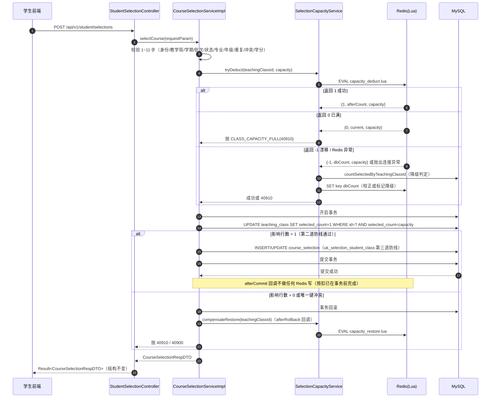
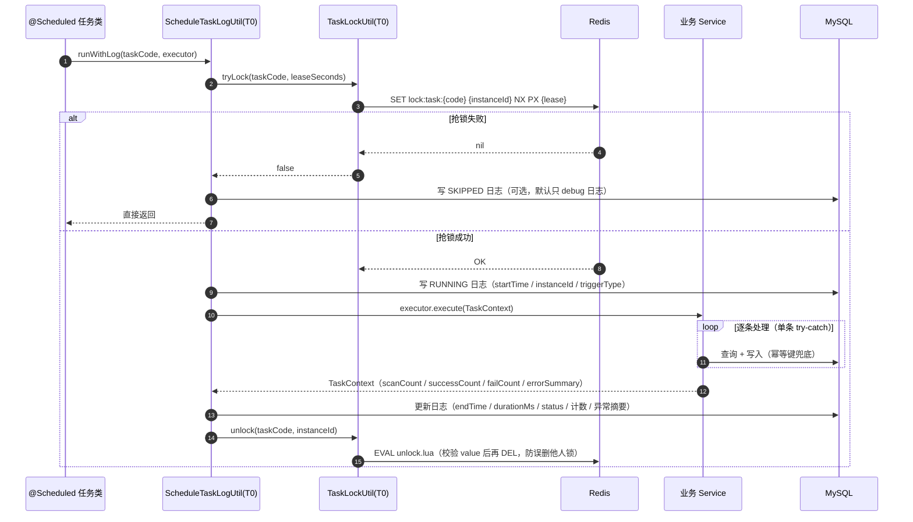
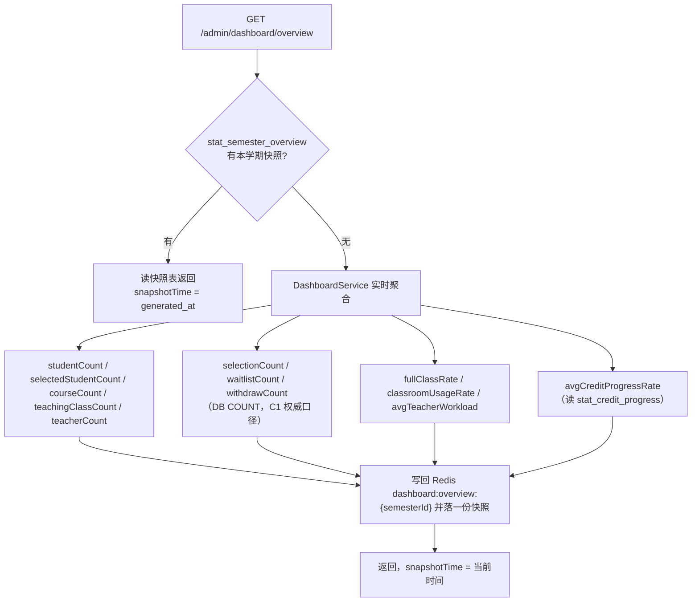
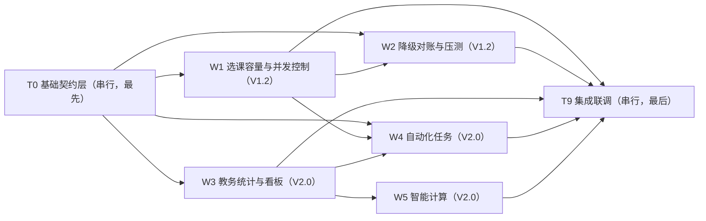

# 高校智慧教务选课平台 V1.2 + V2.0 架构设计与开发计划

> **文档性质**：技术设计 + 任务分解。回答「怎么做、谁来做、做到什么算完成」。
> **上游依据**：`docs/V1.2_V2.0_增量PRD.md`（需求唯一来源）、`docs/接口文档.md`（V1 契约，92 接口）、`docs/V1.1_开发计划.md`（本文件的格式范本）。
> **基线现状**（已核实）：209 个 Java 文件 / 18 张表 / 92 个接口；JDK 21 + Spring Boot 3.2.5 + MyBatis-Plus 3.5.14 + MySQL 8 + Redis + Hutool 5.8.29 + POI 5.4.1 + Knife4j 4.5.0 + spring-boot-starter-aop；**无 MQ、无 Quartz / XXL-Job**。
> **本轮纪律**：不新增任何第三方依赖；不改动 §1~§25 的 92 个接口路径与响应结构；不引入 MQ 与调度框架。

---

# 1. 版本定位与架构总览

## 1.1 两个版本的分层落点

```text
                         V1.2 高并发优化版（写链路）          V2.0 智慧教务版（读链路 + 自动化）
                    ┌───────────────────────────────┐     ┌──────────────────────────────────────┐
controller          │  AdminSelectionCacheController │     │ AdminTrainingPlanController          │
                    │  AdminCacheReconcileController │     │ AdminStatisticsController            │
                    │  （StudentSelectionController  │     │ AdminDashboardController             │
                    │    路径不变，只换内部实现）      │     │ AdminScheduleTaskController          │
                    │                               │     │ AdminAnalyticsController             │
                    │                               │     │ StudentCreditProgressController      │
                    │                               │     │ StudentGraduationRiskController      │
                    │                               │     │ TeacherWorkloadController            │
                    │                               │     │ TeacherScoreWarningController        │
                    └───────────────┬───────────────┘     └──────────────────┬───────────────────┘
                                    │                                        │
service                 ┌───────────▼───────────┐         ┌──────────────────▼───────────────────┐
                        │ SelectionCapacity     │         │ TrainingPlanService                  │
                        │   Service（新增）      │         │ CreditProgressService                │
                        │ CourseSelectionService│         │ ClassroomUsageService                │
                        │   Impl（改造，V1.2独占）│         │ TeacherWorkloadService               │
                        │ WaitlistServiceImpl   │         │ CourseSelectionAnalysisService       │
                        │   （改造，W1独占）      │         │ DashboardService                     │
                        │ CacheReconcileService │         │ GraduationRiskService                │
                        └───────────┬───────────┘         │ EnrollmentForecastService            │
                                    │                     │ ScoreAnomalyService                   │
task / event            ┌───────────▼───────────┐         │ ClassroomRecommendService            │
                        │ SelectionCacheWarmup  │         └──────────────────┬───────────────────┘
                        │   Task                │                            │
                        │ SelectionCache        │         ┌──────────────────▼───────────────────┐
                        │   ReconcileTask       │         │ SelectionBatchStatusTask             │
                        └───────────┬───────────┘         │ WaitlistPromoteScanTask              │
                                    │                     │ StatisticsSnapshotTask               │
                                    │                     │ DashboardCacheRefreshTask            │
                                    │                     │ CreditWarningTask                    │
                                    │                     │ DataAuditTask / SemesterArchiveTask  │
                                    │                     │ ScoreStatisticsEventListener         │
                                    │                     └──────────────────┬───────────────────┘
common（T0 契约）        ┌───────────▼───────────────────────────────────────▼───────────────────┐
                        │ RedisCommonConstant / RedisKeyUtil / ResultCodeEnum / TaskCodeEnum    │
                        │ TaskLockUtil / ScheduleTaskLogService / ScheduleTaskLogUtil           │
                        │ NoticeTypeEnum 扩展 / RiskLevelEnum / StatTypeEnum                     │
                        │ 各 Mapper 的 default 查询方法契约（一次性交付）                          │
                        └───────────────────────────────┬───────────────────────────────────────┘
                                                        │
mapper / entity         ┌───────────────────────────────▼───────────────────────────────────────┐
                        │ 已有 18 张表 Mapper + 新增 9 张表 Mapper（training_plan / stat_* /     │
                        │ schedule_task_log / data_audit_issue / semester_archive）             │
                        └───────────────────────────────────────────────────────────────────────┘
```

## 1.2 V1.2 选课写链路（改造后）



## 1.3 V2.0 自动化任务执行链路



## 1.4 V2.0 统计读链路



---

# 2. 技术选型决议表

## 2.1 PRD §8.1 技术选型类（Q1~Q5）

| # | 问题 | **架构决议** | 理由 | 代价 / 缓解 |
|---|---|---|---|---|
| **Q1** | 接口文档新章节起始编号 | **A：新增接口从 §34 起编号**，§26~§33 原样保留 | 已逐条核实 `docs/接口文档.md`：§25 是最后一个业务接口章（教师成绩统计），§26 事务边界建议、§27 Controller 模块建议、§28 Service 模块建议、§29 推荐 DTO 划分、§30 V1 核心接口优先级、§31 已实现接口总览（92 个）、§32 后续版本接口预留、§33 接口设计总结 —— **全部是非接口章节，无一节被业务接口占用**。文档共 5777 行，§33 之后为空。故 §34 起编号安全且最小改动，不破坏任何既有锚点 | 编号与"内容顺序"不完全对应（§34 之后是业务接口，而 §26~§33 是建议类附录）。在 §34 开头加一句"本章起为 V1.2 / V2.0 新增接口，§26~§33 为设计附录"即可 |
| **Q2** | 调度框架选型 | **A：沿用 Spring `@Scheduled` + Redis 分布式锁**；cron 不硬编码，统一写 `@Scheduled(cron = "${smart-university.schedule.tasks.xxx.cron:默认值}")`，周期值集中在 `application.yml` | ① 零新增依赖，符合"不引入 Quartz / XXL-Job"硬约束；② V1.1 的 `SelectionBatchNoticeTask` 已经是 `@Scheduled(fixedDelay)` 先例，`WebConfiguration` 已 `@EnableScheduling`；③ 课程项目单体部署，独立调度中心的运维成本远大于收益；④ 把 cron 抽成占位符后，**改周期不需要改代码，只需改 yml 重启** | 不支持"教务在页面上改任务周期"；无可视化控制台。缓解：A-07 提供 `GET /admin/schedule-tasks`、`POST /admin/schedule-tasks/{taskCode}/run` 与逐任务开关，覆盖演示与救急。若用户明确要"页面改周期"，则必须改选 Quartz（届时需开新评估，不在本版范围） |
| **Q3** | 是否回补 MQ | **A：不引入 MQ**。事件走 Spring `ApplicationEvent` + `@TransactionalEventListener(AFTER_COMMIT, fallbackExecution = true)`，跨实例/失败补偿走定时兜底扫描 | ① 单体应用，事件生产与消费在同一 JVM，MQ 带来的部署/运维/事务一致性成本大于收益；② V1.1 的 `NotificationEventListener` 已经跑通该模型，`uk_notice_dedup` 提供幂等；③ RocketMQ 已在 `b627b2b` / `a2b65a5` 移除，回补属"技术倒退" | **可靠性边界必须写清楚**：`AFTER_COMMIT` 只能保证"事务提交后才执行"，不能保证"一定执行"——进程在提交后、监听前崩溃则事件丢失。故：凡是**不可丢失**的联动（递补、统计、预警）一律不依赖事件，必须配定时兜底扫描（`WAITLIST_SCAN_TASK` / `STAT_SNAPSHOT_TASK` / `CREDIT_WARNING_TASK`），事件只用于"降低延迟"，兜底扫描用于"保证最终一致"。幂等三件套：`uk_notice_dedup(notice_type, biz_id, receiver_user_id)` + 状态机单向推进 + 快照唯一键覆盖写 |
| **Q4** | 统计是否落快照表 | **A：落快照表（`stat_*` 共 5 张）+ Redis 看板缓存**。实时聚合作为兜底，二者互为备份 | ① V2.0 定位是数据分析平台，快照是趋势对比与"数据快照时间"指标的前提；② 快照让教务首页响应稳定在毫秒级；③ 快照失败不影响正确性（实时兜底） | 多 5 张表 + 1 个刷新任务 + 对账成本。缓解：Q12 决议"每学期只保留最新一份"，唯一键 `(semester_id, stat_type, biz_id, stat_date)` 覆盖写，表体积可控；快照任务错峰（默认 02:00）+ 单次扫描上限 500 条（C3） |
| **Q5** | 多实例任务互斥 | **A：Redis 分布式锁**，Key `edu:smart-university:lock:task:{taskCode}`，value = `instanceId:threadId:uuid`，`SET key value NX PX {leaseMs}`，释放走 Lua 校验 value 后 `DEL` | ① 成本就是一个 `SET NX PX`，无新依赖；② 顺带解决压测/演示环境重复执行；③ value 带实例标识 + Lua 校验释放，可防误删他人锁、防超时后误删 | 任务执行超过 lease 会提前失锁（他人可抢占）。缓解：lease 默认 300s，任务内强制"限量扫描 + 单行 try-catch"，单轮耗时可控；不实现续期（watchdog），避免复杂度 |

## 2.2 补充决议（架构师新增）

| # | 议题 | 决议 | 理由 |
|---|---|---|---|
| **D1** | 并发兜底用什么条件更新 | 给 `teaching_class` **新增 `selected_count` 冗余列**，事务内 `UPDATE teaching_class SET selected_count = selected_count + 1 WHERE id = ? AND selected_count < ?`，影响行数 = 1 才算抢到名额 | PRD P-04 明确要求"条件更新防越界"。不用 `SELECT COUNT(*)`（一致性非锁定读，读不到未提交数据），不用 `SELECT ... FOR UPDATE`（串行化，1000 并发下必然成为瓶颈）。条件更新只在该教学班行上加极短行锁，且已被 Redis 预扣过滤掉 99% 流量。**约束：`selected_count` 仅作并发写入互斥器，严禁被任何统计/看板/对外接口读取**——统计口径仍唯一为 `COUNT(course_selection WHERE status='SELECTED')`（C1） |
| **D2** | Lua 脚本怎么加载 | 脚本文件放 `src/main/resources/lua/*.lua`，新增 `config/SelectionRedisConfiguration` 注册 `RedisScript<Long>` / `RedisScript<List>` Bean，启动时一次性加载 | 避免每次执行读文件；`DefaultRedisScript` 返回类型用 `List` 兼容多返回值 |
| **D3** | Redis 计数 Key 语义 | 新增 `teaching-class:selected-count:{id}`，语义明确为**已选人数**；V1.1 遗留的 `teaching-class:capacity:{id}` 保持常量不删（避免破坏编译），但 V1.2 起不再读写 | 现有 `deductCapacity` 里该 Key 存的其实是"已选人数"，命名与注释（"剩余容量"）相反，是 V1.1 的历史债。新 Key 命名与语义一致 |
| **D4** | 退课 / 递补的 Redis 回补时机 | **事务提交后**回补：用 `TransactionSynchronizationManager.registerSynchronization` 的 `afterCommit` 回调执行 `capacity_restore.lua`；预扣失败/事务回滚用 `afterCompletion(STATUS_ROLLED_BACK)` 补偿 | 若回补写在事务内，事务回滚会导致"名额凭空多一个"（计数泄漏）。回补放在提交后，最坏情况是回补失败 → 计数偏高 → 由 `CACHE_RECONCILE_TASK` 每 30 分钟校正，方向是"少卖"而非"超卖"，安全 |
| **D5** | 「已选人数」读数接口 | 全项目新增**唯一入口** `SelectionCapacityService#getSelectedCount(teachingClassId)`：默认走 DB `COUNT`；只有并发预扣减路径才直接调 Lua | 从源头杜绝"统计读 Redis"的违规实现，落实 C1 |
| **D6** | 智能计算的"智能"边界 | 全部为**规则 + 统计推断 + 可解释的打分模型**（线性加权 / 阈值判定 / 历史均值外推），不引入任何外部 LLM 或 AI 服务 | 对齐 PRD Q14 建议与 §19"排除 AI 聊天助手"的边界 |
| **D7** | 压测工具 | Python `concurrent.futures.ThreadPoolExecutor` 脚本（`scripts/stress/selection_stress.py`），直连 HTTP，不引入 JMeter / Gatling | 零依赖、可版本化、结果可直接写进报告；1000 并发需要约 1000 线程，脚本侧分批启动即可 |
| **D8** | 配置组织 | 全部新增配置集中在 `application.yml` 的 `smart-university:` 段下（`selection` / `cache` / `schedule` / `statistics` / `snapshot`），环境差异只在 `application-dev.yml` / `application-prod.yml` 覆盖 `server-ip` | 与现有风格一致；T0 一次交付后并行期冻结 |

---

# 3. Redis Key 设计规范

> 前缀统一 `edu:smart-university:`（`RedisCommonConstant.KEY_PREFIX`）。T0 一次性交付，**并行期禁止再改 `RedisCommonConstant` / `RedisKeyUtil`**；确需新增走「追加开关」（见 §11.3）。

| # | Key 模式 | 用途 | 类型 | TTL | 写入方 | 失效 / 更新策略 |
|---|---|---|---|---|---|---|
| 1 | `teaching-class:selected-count:{teachingClassId}` | 教学班**已选人数**计数（V1.2 正式 Key，并发预扣减用） | String(整数) | 24h，每次 Lua 执行续 `EXPIRE` | W1（Lua）、W1（预热）、W2（对账） | 预热覆盖写；退课/递补 Lua 回补；对账以 DB 为准 `SET`；教学班停用/删除主动 `DEL` |
| 2 | `teaching-class:capacity:{teachingClassId}` | **V1.1 遗留**，语义同为已选人数 | String | 24h | — | V1.2 起停止读写，24h 自然过期；常量保留不删 |
| 3 | `teaching-class:major:{teachingClassId}` | 教学班开放专业 ID 集合 | Set | 12h | W1 | 教学班专业维护变更时 `DEL` |
| 4 | `teaching-class:grade:{teachingClassId}` | 教学班开放年级 ID 集合 | Set | 12h | W1 | 教学班年级维护变更时 `DEL` |
| 5 | `teaching-class:waiting-count:{teachingClassId}` | 教学班候补人数 | String | 24h | W1 | 候补加入 / 取消 / 递补时 `DEL`（下次访问懒加载） |
| 6 | `teaching-class:waitlist-no:{teachingClassId}` | 候补序号自增器 | String | **不设过期**（永久） | W1 | **严禁设置 TTL**：序号必须单调递增，过期会让序号回退到 1，位次错乱 |
| 7 | `semester:current` | 当前生效学期 JSON | String | 30min | W1 | 学期新增 / 修改 / 状态变更时 `DEL` |
| 8 | `selection-batch:current:{semesterId}` | 当前生效选课批次 JSON | String | 10min | W1 / W4 | 批次保存 / 状态变更时 `DEL` |
| 9 | `student:schedule:{studentId}` | 学生已选课程时间占用 | Hash | 12h | W1 | 选课 / 退课 / 递补成功后 `DEL` |
| 10 | `selection:lock:{studentId}:{teachingClassId}` | 防重复提交锁 | String | 10s | W1 | 自动过期，不主动删 |
| 11 | `lock:task:{taskCode}` | 分布式任务锁 | String | 由 `leaseSeconds` 决定，默认 300s | T0 `TaskLockUtil` | Lua 校验 value 后 `DEL`；异常时靠 TTL 兜底释放 |
| 12 | `dashboard:overview:{semesterId}` | 教务看板聚合缓存 | String(JSON) | 15min | W4（刷新任务）、W3（懒加载） | 刷新任务覆盖写；为空时首次访问懒加载重建 |
| 13 | `selection:degraded` | 选课容量缓存**降级标记**（值 = 降级发生时间戳） | String | 60s | W2 / W1 | Redis 恢复、Lua 调用成功后 `DEL`；可通过 `GET /admin/cache/status` 查询 |
| 14 | `stat:snapshot-time:{semesterId}` | 本学期统计快照生成时间 | String | 24h | W4 | 快照任务覆盖写 |

**命名硬约束**：

- 常量名全大写 + 下划线，模板串用 `%s` 占位，构建方法统一 `RedisKeyUtil.buildXxxKey(...)`；
- 任何 Key 都必须声明 TTL（除第 6 项候补序号自增器，已在表中说明理由）；
- **统计类接口一律不得读取第 1、5 项计数 Key**（C1 红线，Code Review 检查点）。

---

# 4. Lua 脚本设计

脚本文件位置：`src/main/resources/lua/`，由 `config/SelectionRedisConfiguration`（W1 归属）注册为 `DefaultRedisScript`。

## 4.1 选课扣减 `capacity_deduct.lua`

```lua
-- KEYS[1] 教学班已选人数计数 Key
-- ARGV[1] capacity         教学班容量
-- ARGV[2] dbCount          数据库权威已选人数（用于冷启动与漂移校正）
-- ARGV[3] ttlSeconds       Key 过期时间
-- 返回 {code, count, capacity}
--   code =  1  扣减成功，count 为扣减后的计数
--   code =  0  名额已满（不扣减）
--   code = -1  计数漂移，已用 dbCount 覆盖校正，本次不扣减（调用方回落到 DB 判定）
local key        = KEYS[1]
local capacity   = tonumber(ARGV[1])
local dbCount    = tonumber(ARGV[2])
local ttl        = tonumber(ARGV[3])

local current = tonumber(redis.call('GET', key))
if current == nil then
    current = dbCount
    redis.call('SET', key, current, 'EX', ttl)
elseif current < 0 or current > capacity then
    redis.call('SET', key, dbCount, 'EX', ttl)
    return { -1, dbCount, capacity }
end

if current >= capacity then
    return { 0, current, capacity }
end

local after = redis.call('INCR', key)
redis.call('EXPIRE', key, ttl)
if after > capacity then
    redis.call('DECR', key)
    return { 0, capacity, capacity }
end
return { 1, after, capacity }
```

**与 DB 条件更新如何配合形成双保险**

| 层 | 作用 | 失败后果 |
|---|---|---|
| Redis Lua 预扣（第 1 道） | 在到达数据库前拦截掉绝大多数超额请求，把热点 DB 写压力降到 1/capacity 量级 | 拦不住也没关系，第 2 道会拦 |
| `UPDATE teaching_class SET selected_count = selected_count + 1 WHERE id = ? AND selected_count < ?`（第 2 道） | 行级条件更新，**唯一真正防止超卖的强制约束**；影响行数 = 0 即判满 | 返回 40910，并回滚 Redis 预扣 |
| `uk_selection_student_class(student_id, teaching_class_id)`（第 3 道） | 兜住重复选课 | 抛 `DuplicateKeyException` → 全局处理器转 `40900`，并回滚 Redis 预扣 |

三条防线全部落在同一个 `@Transactional` 内：**任一失败 → 事务回滚 + `afterCompletion(ROLLED_BACK)` 回调执行 `capacity_restore.lua` 补偿预扣**。

## 4.2 退课 / 递补回补 `capacity_restore.lua`

```lua
-- KEYS[1] 教学班已选人数计数 Key
-- ARGV[1] dbCount      数据库权威已选人数（回补下界）
-- ARGV[2] ttlSeconds   Key 过期时间
-- 返回 {code, count}
--   code = 1 回补完成（count 为回补后的计数）
local key     = KEYS[1]
local dbCount = tonumber(ARGV[1])
local ttl     = tonumber(ARGV[2])

local current = tonumber(redis.call('GET', key))
if current == nil or current <= 0 then
    redis.call('SET', key, dbCount, 'EX', ttl)
    return { 1, dbCount }
end

local after = redis.call('DECR', key)
redis.call('EXPIRE', key, ttl)
if after < dbCount then
    -- 回补过度（历史计数偏低）时以 DB 为准，保证计数永不低于真实值
    redis.call('SET', key, dbCount, 'EX', ttl)
    after = dbCount
end
return { 1, after }
```

**返回值约定统一**：所有脚本返回 `List<Long>`，第 1 位为业务码，后续位为上下文数值；Java 侧封装 `CapacityLuaResult`（`code` / `count` / `capacity`）解析，禁止在 Service 里裸用 `List.get(0)`。

## 4.3 Redis 不可用时的降级路径（P-05）

```
调用 SelectionCapacityService#tryDeduct
   ├─ try { redisTemplate.execute(deductScript, keys, args) }
   │     └─ 成功 → 按 code 返回 SUCCESS / FULL / DRIFT
   └─ catch (RedisConnectionFailureException | RedisSystemException | QueryTimeoutException ex)
         ├─ 1. log.warn("选课容量缓存降级，teachingClassId={}", id, ex)
         ├─ 2. 写降级标记 SET selection:degraded = 当前时间戳 EX 60
         ├─ 3. 回落 DB 判定：dbCount = countSelectedByTeachingClassId(id)
         │       dbCount >= capacity ? 抛 40910 : 视为通过
         └─ 4. 本次不再写 Redis（不预热、不扣减），直接进 DB 事务
```

- **降级时不抛 5xx**：只产生业务结果（成功或 40910），满足 PRD 验收「停掉 Redis 后选课接口仍返回业务结果」。
- **自动恢复**：每次 `tryDeduct` 成功执行 Lua 后 `DEL selection:degraded`；`GET /api/v1/admin/cache/status` 暴露 `degraded` 布尔值。
- **降级期间的正确性完全由 DB 条件更新保证**（第 2 道防线不受 Redis 影响），因此降级不会导致超卖，只是把压力交还给数据库。

---

# 5. 并发一致性方案

## 5.1 四道防线总览

| 防线 | 机制 | 拦截目标 | 实现位置 |
|---|---|---|---|
| ① Redis Lua 预扣 | `capacity_deduct.lua` 原子「判断 + 占用」 | 超卖（挡掉 99% 流量） | `SelectionCapacityServiceImpl`（W1） |
| ② DB 条件更新 | `UPDATE teaching_class SET selected_count = selected_count + 1 WHERE id = ? AND selected_count < ?` | **超卖（强制约束）** | `TeachingClassMapper#updateSelectedCountWithCapacityCheck`（T0 交付签名，W1 调用） |
| ③ DB 唯一键 | `uk_selection_student_class(student_id, teaching_class_id)` + `GlobalExceptionHandler` 的 `DuplicateKeyException → 40900` | 重复选课 | 已存在，V1.2 不改 |
| ④ 事务回滚补偿 | `afterCompletion(STATUS_ROLLED_BACK)` → `capacity_restore.lua` + `UPDATE ... SET selected_count = selected_count - 1` | 计数泄漏 | `SelectionCapacityServiceImpl`（W1） |

## 5.2 超卖如何被双重拦截

- **并发 1000 抢 1 个名额**：Redis Lua 的 `INCR` 是单线程原子操作，只有第 1 个请求看到 `after <= capacity` 并返回 code=1；其余 999 个拿到 code=0 直接 40910，不进入数据库事务。
- **Redis 计数被人为改坏（改成 0）**：Lua 让 1000 个请求全部预扣成功 → 进入 DB 事务 → `UPDATE ... WHERE selected_count < capacity` 只有 1 个影响行数 = 1 → 其余 999 个返回 0 → 抛 40910 + 回滚 + 补偿 Redis。**超卖数 = 0**。
- **Redis 完全宕机**：全部走 DB 判定 + 条件更新，仍然不超卖，只是响应变慢。

## 5.3 重复选课如何被双重拦截

- 第 9 步 `getExistSelection(studentId, teachingClassId)` 命中 `SELECTED` → 40909（业务层）；
- 并发下两个请求同时通过第 9 步 → 同一 `(student_id, teaching_class_id)` 第二次 INSERT 撞 `uk_selection_student_class` → `DuplicateKeyException` → 40900（数据层）。
- 若已有记录是 `WITHDRAWN` / `WAITING` 则走 `UPDATE` 分支（`updateById`），天然单条，无重复风险。

## 5.4 缓存对账（P-07 / `CACHE_RECONCILE_TASK`）

```
每 30 分钟（或手动触发）：
  1. 取当前学期 + 当前批次，通过 selection_batch_class 取教学班 ID（上限 500）
  2. 逐个：
     dbCount    = COUNT(course_selection WHERE teaching_class_id=? AND status='SELECTED')   ← 权威
     redisCount = GET teaching-class:selected-count:{id}
     tcCount    = teaching_class.selected_count
     若 redisCount ≠ dbCount → SET key dbCount（DB 为准）+ diffCount++
     若 tcCount    ≠ dbCount → UPDATE teaching_class SET selected_count = dbCount + diffCount++
  3. 写任务日志（扫描数 / 不一致数 / 校正数）
```

- 校正方向恒为「以 DB 为准」，因此对账本身不可能产生超卖；
- 对账期间选课仍在进行，Redis 值可能瞬时不匹配 → **只记录差异，校正幂等**，下一轮再校正即可；
- 人为改坏 Redis 后，一个周期（≤30 分钟）内自动恢复。

---

# 6. 自动化任务设计

## 6.1 任务基础设施（T0 交付）

| 组件 | 类型 | 职责 |
|---|---|---|
| `TaskCodeEnum` | 枚举 | 全部任务编码 + 中文名 + 默认周期说明 |
| `TaskLockUtil` | 工具类 | `tryLock(taskCode, leaseSeconds)` / `unlock(taskCode, token)`，底层 `SET NX PX` + 释放 Lua |
| `ScheduleTaskLogDO` / `ScheduleTaskLogMapper` / `ScheduleTaskLogService`(+Impl) | 数据层 | 任务执行日志落库与查询 |
| `ScheduleTaskLogUtil` | 工具类 | `runWithLog(taskCode, triggerType, executor)` 模板：抢锁 → 开始日志 → 执行 → 结束日志 → 释放锁；异常全捕获 |
| `TaskContext` | 上下文 | `scanCount` / `successCount` / `failCount` / `errorSummary`，由业务代码累加 |
| `instanceId` | 配置 | `NetUtil.getLocalHostName() + ":" + server.port`，启动时生成一次 |

`unlock` 释放 Lua：

```lua
-- KEYS[1] lock:task:{taskCode}   ARGV[1] 加锁时写入的 value
if redis.call('GET', KEYS[1]) == ARGV[1] then
    return redis.call('DEL', KEYS[1])
end
return 0
```

## 6.2 任务清单

| 任务编码 | 任务名 | 触发方式 | 默认周期（yml 可配） | 幂等键 | 失败兜底 | 归属 | 关联需求 |
|---|---|---|---|---|---|---|---|
| `BATCH_STATUS_TASK` | 选课批次状态自动流转 | 定时 | `fixedDelay=60000`（1 分钟） | 状态机单向推进 `NOT_STARTED→IN_PROGRESS→ENDED`，`WHERE status=?` 条件更新 | 单批次 try-catch 跳过；任务日志 | W4 | A-01 |
| `WAITLIST_SCAN_TASK` | 候补递补兜底扫描 | 定时 | `fixedDelay=300000`（5 分钟） | 递补后 `status→SELECTED`；通知靠 `uk_notice_dedup` | 单教学班失败跳过；递补前重跑全套校验 | W4 | A-02 |
| `STAT_SNAPSHOT_TASK` | 统计快照预计算 | 定时（错峰） | `cron=0 0 2 * * ?`（每日 02:00） | `uk(semester_id, stat_type, biz_id, stat_date)` 覆盖写 | 失败保留上一版，查询自动回落实时计算 | W4 | A-03 |
| `DASHBOARD_REFRESH_TASK` | 看板缓存刷新 | 定时 | `fixedDelay=600000`（10 分钟） | 覆盖写单 Key | 缓存失效后首次访问懒加载重建 | W4 | A-04 |
| `CREDIT_WARNING_TASK` | 学分不足 / 毕业风险预警 | 定时 | `cron=0 0 9 ? * MON`（每周一 09:00） | `uk_notice_dedup` + **`biz_id = semester_id`（决策 2，学生维度由 `receiver_user_id` 承担）** | 单人异常跳过 | W4 | A-05 |
| `SCORE_STAT_EVENT` | 成绩发布后自动统计 | 事件（`@TransactionalEventListener` AFTER_COMMIT） | 成绩发布事务提交后 | 统计覆盖写；通知靠 `uk_notice_dedup` | 监听异常不影响成绩发布 | W4 | A-06 |
| `DATA_AUDIT_TASK` | 异常数据巡检 | 定时 | `cron=0 0 3 * * ?`（每日 03:00） | `uk_data_audit_issue(rule_code, biz_id)` 覆盖写 | 只读不改业务数据；单规则异常跳过 | W4 | A-08 |
| `SEMESTER_ARCHIVE_TASK` | 学期末数据归档 | 定时（默认关闭） | `cron=0 0 4 * * ?`（每日 04:00） | `uk_semester_archive(semester_id, archive_type)` 覆盖写 | 归档失败保留原状态，下轮重试 | W4 | A-09 |
| `CACHE_RECONCILE_TASK` | 缓存一致性对账 | 定时 | `fixedDelay=1800000`（30 分钟） | 以 DB 为准覆盖校正 | 单教学班异常跳过并记录差异 | W2 | P-07 |
| `SELECTION_CACHE_WARMUP_TASK` | 容量缓存预热 | 定时 + 手动 | `cron=0 0/30 * * * ?`（每 30 分钟，仅预热当前批次） | `SET` 覆盖写 | 单教学班失败跳过 | W1 | P-01 |

## 6.3 通用兜底要求（写进每个任务类）

1. 任务方法体整体 `try-catch(Throwable)`，异常不得冒泡到调度线程池；
2. 循环体内逐条 `try-catch`，单条失败累加 `failCount` 并记 `errorSummary` 后继续；
3. 每轮落一条 `schedule_task_log`（任务编码 / 开始 / 结束 / 耗时 / 扫描 / 成功 / 失败 / 异常摘要 / 实例标识 / 触发方式）；
4. 每个任务提供教务端手动触发入口 `POST /api/v1/admin/schedule-tasks/{taskCode}/run`；
5. 每个任务有独立 `enabled` 开关，压测 / 演示可单独停用；
6. 任务启动前抢 Redis 分布式锁，未抢到直接跳过本轮（记 debug 日志，不写库，避免日志表膨胀）。

## 6.4 cron 配置项写法（Q2 落地形态）

```java
@Scheduled(cron = "${smart-university.schedule.tasks.stat-snapshot.cron:0 0 2 * * ?}")
public void execute() {
    scheduleTaskLogUtil.runWithLog(TaskCodeEnum.STAT_SNAPSHOT_TASK, TriggerTypeEnum.SCHEDULED, this::doExecute);
}
```

```yaml
smart-university:
  schedule:
    enabled: true
    lock-lease-seconds: 300
    tasks:
      stat-snapshot:      { enabled: true,  cron: "0 0 2 * * ?" }
      credit-warning:     { enabled: true,  cron: "0 0 9 ? * MON" }
      data-audit:         { enabled: true,  cron: "0 0 3 * * ?" }
      semester-archive:   { enabled: false, cron: "0 0 4 * * ?" }
      batch-status:       { enabled: true,  fixed-delay: 60000 }
      waitlist-scan:      { enabled: true,  fixed-delay: 300000 }
      dashboard-refresh:  { enabled: true,  fixed-delay: 600000 }
      cache-reconcile:    { enabled: true,  fixed-delay: 1800000 }
```

> `fixedDelay` 型任务用 `@ConditionalOnProperty` 或方法内 `if (!enabled) return;` 控制开关（`@Scheduled` 的 `fixedDelayString` 不支持 false 关闭，统一在方法首行判断开关）。

---

# 7. 统计与智能计算实现方案

## 7.1 实时聚合 vs 快照预计算的边界

| 场景 | 方案 | 说明 |
|---|---|---|
| 教务看板 `GET /admin/dashboard/overview` | **优先快照**，无快照实时算 | `stat_semester_overview` 按学期一份 |
| 教室利用率 / 教师工作量 / 课程选课分析（列表查询） | **实时算为主，快照作缓存** | 列表带分页与筛选，实时算保证筛选灵活；`DASHBOARD_REFRESH_TASK` 只刷看板 |
| 学生学分进度 `GET /student/credit-progress` | **实时算**（单学生，数据量小） | 培养方案变更后立即生效（S-01 验收③） |
| 学生学分进度快照 `stat_credit_progress` | **快照**（供看板 `avgCreditProgressRate` 与教务风险名单） | 由 `STAT_SNAPSHOT_TASK` 生成 |
| 毕业风险 / 热度预测 / 成绩异常 / 教室推荐 | **实时算**（规则型，毫秒级） | 不落快照，避免规则调整后要刷历史 |
| 异常数据巡检 | **定时算 + 落表**（`data_audit_issue`） | 结果要可查询、可分类 |

**统一读法**：`StatisticsSnapshotService#readOrCompute(semesterId, statType, computeFunc)` —— 命中快照返回快照，未命中调用 `computeFunc` 并异步回写。

## 7.2 各指标的计算口径（落到 SQL / Wrapper 层）

> 全部遵守 **C1**：已选人数一律 `COUNT(course_selection WHERE status='SELECTED')`，**不读 Redis 计数 Key、不读 `teaching_class.selected_count`**。

| 指标 | 数据链路 | 实现要点 |
|---|---|---|
| `studentCount` | `student` | `selectCount(Wrappers.lambdaQuery().eq(StudentDO::getStatus, 1))`。**注意：`student` 表无学期字段，无法按学期切分**（见 §14 风险 R-03；**Q20 已拍板：保留在册总数口径**） |
| `selectedStudentCount` | `course_selection` | `COUNT(DISTINCT student_id) WHERE batch_id = :currentBatchId AND status='SELECTED'`。**Q20 已拍板「双口径」**：与 `studentCount` 同时输出，38.1 看板必须同时返回两个字段（口径差异见 §12.9） |
| `courseCount` | `teaching_class` | `COUNT(DISTINCT course_id) WHERE semester_id=? AND status IN (AVAILABLE, CLOSED)`；Wrapper 传枚举实例 |
| `teachingClassCount` | `teaching_class` | `selectCount WHERE semester_id=? AND status <> CANCELLED` |
| `teacherCount` | `teaching_class` | 同上取 `teacher_id` 去重计数 |
| `selectionCount` / `waitlistCount` / `withdrawCount` | `course_selection` | `selectCount WHERE batch_id=? AND status=SELECTED / WAITING / WITHDRAWN`（走 `idx_selection_batch_status`） |
| `fullClassRate` | `course_selection` + `teaching_class` + `selection_batch_class` | 分母 = 当前批次 `selection_batch_class` 关联且 `status <> CANCELLED` 的教学班数；分子 = 其中 `selectedCount >= capacity` 的个数（**Q9 决议 A：不含候补**）；分母 0 返回 0；`BigDecimal` 保留 1 位小数 |
| `classroomUsageRate` | `teaching_class_schedule` + `teaching_class` + `classroom` | 分子 = `Σ((end_section-start_section+1) × (end_week-start_week+1))`；分母 = `教室可用数 × daysPerWeek × sectionsPerDay × 学期周数`；**`学期周数 = LEAST(CEIL(DATEDIFF(end_date, start_date)/7), maxWeeks)`（决策 3 / Q19 已拍板：不补 `semester.weeks` 字段，永久走推导）**；`daysPerWeek=5` / `sectionsPerDay=10` / `maxWeeks=20` 均可配（**Q7 已拍板：默认 A，三项参数可配**），且**必须在 37.1 的 `extra` 中回显**（决策 5 固化） |
| `avgTeacherWorkload` | 同上 | `totalHours / teacherCount`，`totalHours` 口径同 `classroomUsageRate` 分子（**Q8 决议 A：1 节课 = 1 课时，不引入课程系数**） |
| `avgCreditProgressRate` | `stat_credit_progress` | `AVG(progress_rate)`，仅统计 `has_plan=1` 的学生 |
| `unpublishedClassCount` | `course_selection` + `score` | 本学期存在 `SELECTED` 记录且该 `course_selection_id` 无 `score` 或 `score.status=UNPUBLISHED` 的教学班去重计数 |
| `batchStatus` | `selection_batch` | 无批次时返回 `NOT_STARTED` |
| `snapshotTime` | `stat_semester_overview.generated_at` 或当前时间 | — |

### S-03 教室利用率（按教室 / 按教学楼 / 按星期节次 / 空闲时段）

```text
1. 一次性捞出本学期全部排课：TeachingClassScheduleMapper#listScheduleBySemesterId(semesterId)
   （inSql: teaching_class_id IN (SELECT id FROM teaching_class WHERE semester_id = ?)）
2. 内存聚合到 Map<classroomId, List<schedule>>（课程项目量级 ≤ 数千条，无需 SQL GROUP BY）
3. 按教室：usageCount = 排课条数；usageHours = Σ((end-start+1)×(endWeek-startWeek+1))
   usageRate = usageHours / (daysPerWeek × sectionsPerDay × 学期周数) × 100，上限 100
4. 按教学楼：按 classroom.building_name 分组汇总（新增 idx_classroom_building）
5. 按星期/节次热力：Map<"weekday-section", count>
6. 空闲时段：遍历 (classroom × weekday × section) 全组合，未被任何排课覆盖即为空闲
   （教室数 × 7 × sectionsPerDay 组合，可控）
```

### S-04 教师工作量

```text
classCount    = COUNT(teaching_class WHERE teacher_id=? AND semester_id=? AND status<>CANCELLED)
totalHours    = Σ((end_section-start_section+1) × (end_week-start_week+1))，取该教师本学期全部教学班的排课
studentCount  = COUNT(course_selection WHERE teaching_class_id IN (该教师教学班) AND status='SELECTED')
教师端只能查自己：teacherId 一律从 UserContextHolder.getTeacherId() 取
```

### S-05 课程选课分析

```text
按 course + teaching_class 聚合：
  selectedCount  = COUNT(cs WHERE teaching_class_id=? AND status='SELECTED')   ← C1 权威
  withdrawCount  = COUNT(cs WHERE teaching_class_id=? AND status='WITHDRAWN')  ← 只计最终退课态
  fullFlag       = selectedCount >= teaching_class.capacity（不含候补）
专业分布：cs JOIN student → GROUP BY student.major_id（内存聚合）
年级分布：cs JOIN student → GROUP BY student.grade_id
自检：专业分布合计 == 年级分布合计 == selectedCount（写进单元测试式验收）
```

### S-02 / I-01 学分进度与毕业风险（C8：跨学期累计，独立实现）

> ⚠️ **C8 硬红线（最严重冲突，全量贯彻）**：V1.1 `CreditServiceImpl#getCreditSummary` 走
> `ScoreMapper.listPublishedScoreByStudent`（内部 `JOIN teaching_class tc ... WHERE tc.semester_id = :semesterId`），
> 且 `buildCourseMapOfSelection` 的入参选课记录同样带 `semester_id` 过滤 ——
> **其 `completedCredit` 实为「本学期已修得学分」，不是跨学期累计**。
> **S-02 / I-01 一律禁止复用**：`CreditServiceImpl`、`ScoreMapper#listPublishedScoreByStudent`、
> `buildCourseMapOfSelection`，以及**任何带 `semester_id` 过滤的学分/成绩方法**。
> 复用会得出「学生永远毕不了业」的错误进度。

**跨学期累计实现方案（新增方法已进 §11.7 冻结清单）**

```text
1. ScoreMapper#listPublishedScoreByStudentId(studentId)          ← 新增（C8 专用，无学期过滤）
   SQL 形态：SELECT * FROM score
             WHERE status = 'PUBLISHED'
               AND course_selection_id IN (SELECT id FROM course_selection WHERE student_id = ?)
2. CourseSelectionMapper#listSelectionByStudentId(studentId)      ← 新增（C8 专用，返回该学生全部学期的选课记录）
   SQL 形态：SELECT * FROM course_selection WHERE student_id = ? （不拼任何 semester 子查询）
3. 内存补齐课程维度（沿用已有方法，不新增）：
   TeachingClassMapper#listTeachingClassByIds(ids) → CourseMapper#listCourseByIds(ids)
   得到 Map<courseId, CourseDO>（course.credit / course.course_type）
4. 遍历 publishedScore → courseSelectionId → teachingClassId → courseId → course
   计入条件（决策 1：沿用「发布即计入」，不改 V1.1）：
     completedCredit  += course.credit            （已发布即计入，与 V1.1 口径一致）
     passedCredit     += course.credit if score_value >= passScore（默认 60，附加字段）
     按 course_type 分桶同步累加 required / majorElective / publicElective
5. progressRate = completedCredit / training_plan.total_credit × 100
```

- **计入条件唯一来源**：`score.status = 'PUBLISHED'`；**不追加 `>= 60` 作为计入门槛**（决策 1）。
- `passedCredit` 只是**附加输出**，不参与 `progressRate` / 风险等级计算；字段名与 V1.1 的 `completedCredit` 严格区分。
- **重修不去重**：同一课程多次通过会重复计入，与 V1.1 行为一致；配置项 `credit.dedup-by-course` 预留为 `false`（见 §14.1 C9）。
- I-01 复用 S-02 的同一份累计结果，**不得另算一套**（验收 40.1 与 36.1 数值必须一致）。

```text
培养方案：training_plan WHERE major_id=? AND grade_id=? AND status=1（Q11 决议 A：专业 + 入学年级）
剩余学期数 = 学制（默认 4，可配）× 2 − 已读学期数 + 1
  · 已读学期数 = COUNT(semester WHERE start_date >= 入学学期 start_date AND start_date <= 统计截止学期 start_date)，按学期表实算，最小剩余为 1
  · 示例（统计学期 2026-2027-1）：2026级=8、2025级=6、2024级=4、2023级=2、2022级=1
需求速率 = (total_credit − completedCredit) / 剩余学期数
风险等级：需求速率 > 学期最大学分上限 × 0.8 → HIGH；> 0.6 → MEDIUM；否则 LOW（阈值可配）
无培养方案：返回 hasPlan=false + 提示文案，不抛异常
```

> **两处口径必须分别标注，不可混用**：
> V1.1 `GET /student/credits` 的 `completedCredit` = **本学期 + 发布即计入**；
> V2.0 S-02 / I-01 的 `completedCredit` = **跨学期累计 + 发布即计入**（独立实现）。

### I-02 选课热度预测与扩容建议

```text
历史需求 = 往期（其他学期）同 course_id 的 SELECTED 人次均值；样本期数 < 2 → 返回 sampleInsufficient=true + "样本不足"
当期潜在需求 = 已选人次 + 候补人次
预测需求 = max(历史需求, 当期潜在需求 × expansionFactor 默认 1.2)
建议容量增量 = 预测需求 − 当前容量（> 0 才建议）
爆满标志 = 预测需求 > 容量
```

### I-03 成绩分布异常预警

```text
及格率 = COUNT(score_value >= 60) / COUNT(*)；优秀率 = COUNT(score_value >= 85) / COUNT(*)
五段分布：0-59 / 60-69 / 70-79 / 80-84 / 85-100
录入完整率 = 有 score 记录数 / SELECTED 人数
基线 = 同 course_id 历史教学班及格率均值；无历史 → 取全校本学期均值
异常判定（阈值可配）：
  及格率 < 基线 − 15 个百分点 → FAIL_RATE_HIGH
  录入完整率 < 100% 且已过发布窗口 → SCORE_MISSING
  优秀率 > 60% → SCORE_TOO_HIGH
教师端只返回自己任教的教学班（teacher_id 从 UserContextHolder 取 + 归属校验）
```

### I-04 排课冲突检测与教室推荐

```text
候选教室：classroom.status=1 AND classroom.capacity >= teaching_class.capacity
冲突排除：与候选教室已有排课在「weekday + 教学周区间 + 节次区间」三维度同时相交 → 剔除
          （复用 CourseSelectionServiceImpl#isConflict 的同款判定，抽到 T0 的 ScheduleConflictUtil）
排序：容量冗余（classroom.capacity − teaching_class.capacity）升序 → 同教学楼优先 → room_no 升序
取 Top N（默认 5），推荐理由为中文说明文本
只做推荐，不做自动排课求解（Q15）
```

### ~~I-05 个性化课程推荐~~ —— 已砍除（决策 4）

> **用户已确认砍除，V2.0 不做。** 连带删除：接口 42.4、`CourseRecommendService`(+Impl)、
> `RecommendedCourseRespDTO`、W5-5 子任务。**编号 42.4 回收，不再使用**（不递补其他接口顶替，
> 避免与已完成联调的编号体系错位）。V2.0 需求条数由 20 条调整为 **19 条**（见 §15.1）。

---

# 8. 数据库增量设计说明

完整脚本见 **`docs/V1.2_V2.0_数据库增量设计.sql`**（可直接执行的 MySQL 8 脚本，幂等）。

## 8.1 新增表（9 张）

| 表名 | 用途 | 归属版本 | 归属工作流 | 唯一键（幂等 / 覆盖写依据） |
|---|---|---|---|---|
| `training_plan` | 培养方案：专业 + 年级的学分要求 | V2.0 | W3 | `uk_training_plan_major_grade(major_id, grade_id)` |
| `stat_classroom_usage` | 教室利用率快照 | V2.0 | W3 | `uk_stat_classroom(semester_id, classroom_id, stat_date)` |
| `stat_teacher_workload` | 教师工作量快照 | V2.0 | W3 | `uk_stat_teacher(semester_id, teacher_id, stat_date)` |
| `stat_course_selection` | 课程选课分析快照 | V2.0 | W3 | `uk_stat_course(semester_id, teaching_class_id, stat_date)` |
| `stat_credit_progress` | 学生学分进度快照 | V2.0 | W3 | `uk_stat_credit(semester_id, student_id, stat_date)` |
| `stat_semester_overview` | 教务看板指标快照 | V2.0 | W3 | `uk_stat_overview(semester_id, stat_date)` |
| `schedule_task_log` | 定时任务执行日志 | 公共 | T0 | 无唯一键（每轮追加一条） |
| `data_audit_issue` | 异常数据巡检结果 | V2.0 | W4 | `uk_audit_issue(rule_code, biz_id)` |
| `semester_archive` | 学期归档固化结果 | V2.0 | W4 | `uk_semester_archive(semester_id, archive_type)` |

## 8.2 存量表改造（2 项）

| 改动 | 理由 | 风险 |
|---|---|---|
| `teaching_class` 新增 `selected_count INT UNSIGNED NOT NULL DEFAULT 0` | D1：事务内条件更新防超卖的第二道防线 | **仅作并发写入互斥器**，统计严禁读取（C1）；脚本内用 `COUNT(course_selection)` 初始化存量数据 |
| `notification` 的 `chk_notice_type` CHECK 重建，新增 `CREDIT_WARNING` / `SCORE_ANOMALY` | V2.0 新增两类站内通知 | 需 `DROP CHECK` + `ADD CHECK`，脚本已按 `information_schema` 判存 |

## 8.3 索引新增

| 表 | 索引 | 用途 |
|---|---|---|
| `course_selection` | `idx_selection_batch_status(batch_id, status)` | 看板 selection / waitlist / withdraw 三指标 |
| `course_selection` | `idx_selection_class_status_withdraw(teaching_class_id, status)` | 已有 `idx_selection_class_status`，保留；新增覆盖退课统计（如已存在则跳过） |
| `teaching_class` | `idx_tc_semester_teacher(semester_id, teacher_id)` | 教师工作量按学期聚合 |
| `teaching_class` | `idx_tc_semester_status_teacher(semester_id, status, teacher_id)` | 看板 teacherCount + 教师工作量联合过滤 |
| `teaching_class_schedule` | `idx_schedule_weekday_section(weekday, start_section, end_section)` | 教室空闲时段计算 |
| `classroom` | `idx_classroom_building(building_name)` | 按教学楼汇总利用率 |
| `classroom` | `idx_classroom_status(status)` | 分母：可用教室数 |
| `student` | `idx_student_status(status)` | 看板 studentCount |
| `score` | `idx_score_status_value(status, score_value)` | 学分进度（PUBLISHED + 及格）与成绩异常基线 |
| `score` | `idx_score_published_at(status, published_at)` | 成绩发布窗口巡检 |

---

# 9. 接口清单

> **Q1 决议：新增接口从 §34 起编号**，完整字段级契约见 **`docs/V1.2_V2.0_接口清单.md`**，最终统一补录进 `docs/接口文档.md`（T9 负责）。

| 编号 | 方法 | 路径 | 角色 | 归属版本 | 工作流 | 说明 |
|---|---|---|---|---|---|---|
| 34.1 | POST | `/api/v1/admin/selection-batches/{batchId}/cache/warmup` | ADMIN | V1.2 | W1 | 容量计数预热 |
| 34.2 | GET | `/api/v1/admin/cache/status` | ADMIN | V1.2 | W1 | 缓存状态与降级标记查询 |
| 34.3 | POST | `/api/v1/admin/cache/reconcile` | ADMIN | V1.2 | W2 | 手动触发一致性对账 |
| 35.1 | GET | `/api/v1/admin/training-plans` | ADMIN | V2.0 | W3 | 培养方案分页 |
| 35.2 | POST | `/api/v1/admin/training-plans` | ADMIN | V2.0 | W3 | 新增培养方案 |
| 35.3 | GET | `/api/v1/admin/training-plans/{planId}` | ADMIN | V2.0 | W3 | 培养方案详情 |
| 35.4 | PUT | `/api/v1/admin/training-plans/{planId}` | ADMIN | V2.0 | W3 | 修改培养方案 |
| 35.5 | PATCH | `/api/v1/admin/training-plans/{planId}/status` | ADMIN | V2.0 | W3 | 启停培养方案 |
| 36.1 | GET | `/api/v1/student/credit-progress` | STUDENT | V2.0 | W3 | 学生学分进度 |
| 36.2 | GET | `/api/v1/student/graduation-risk` | STUDENT | V2.0 | W5 | 毕业风险预测 |
| 37.1 | GET | `/api/v1/admin/statistics/classroom-usage` | ADMIN | V2.0 | W3 | 教室利用率 |
| 37.2 | GET | `/api/v1/admin/statistics/teacher-workload` | ADMIN | V2.0 | W3 | 教师工作量 |
| 37.3 | GET | `/api/v1/admin/statistics/course-selection` | ADMIN | V2.0 | W3 | 课程选课分析 |
| 37.4 | POST | `/api/v1/admin/statistics/snapshots/refresh` | ADMIN | V2.0 | W4 | 手动触发统计快照 |
| 38.1 | GET | `/api/v1/admin/dashboard/overview` | ADMIN | V2.0 | W3 | 教务数据看板 |
| 39.1 | GET | `/api/v1/teacher/workload` | TEACHER | V2.0 | W3 | 教师本人工作量 |
| 39.2 | GET | `/api/v1/teacher/score-warnings` | TEACHER | V2.0 | W5 | 教师成绩异常预警 |
| 40.1 | GET | `/api/v1/admin/analytics/graduation-risks` | ADMIN | V2.0 | W5 | 毕业风险名单 |
| 40.2 | GET | `/api/v1/admin/analytics/enrollment-forecast` | ADMIN | V2.0 | W5 | 选课热度预测与扩容建议 |
| 40.3 | GET | `/api/v1/admin/analytics/score-anomalies` | ADMIN | V2.0 | W5 | 成绩分布异常班级 |
| 40.4 | GET | `/api/v1/admin/analytics/classroom-recommendations` | ADMIN | V2.0 | W5 | 教室推荐 |
| 41.1 | GET | `/api/v1/admin/schedule-tasks` | ADMIN | V2.0 | W4 | 任务列表与最近状态 |
| 41.2 | GET | `/api/v1/admin/schedule-tasks/{taskCode}/logs` | ADMIN | V2.0 | W4 | 任务执行日志 |
| 41.3 | POST | `/api/v1/admin/schedule-tasks/{taskCode}/run` | ADMIN | V2.0 | W4 | 手动触发任务 |
| 42.1 | GET | `/api/v1/admin/warnings/credit` | ADMIN | V2.0 | W4 | 学分风险名单 |
| 42.2 | GET | `/api/v1/admin/data-audit/issues` | ADMIN | V2.0 | W4 | 异常数据巡检结果 |
| 42.3 | POST | `/api/v1/admin/semesters/{semesterId}/archive` | ADMIN | V2.0 | W4 | 学期归档 |
| ~~42.4~~ | ~~GET~~ | ~~/api/v1/student/recommended-courses~~ | — | — | — | **已砍除（决策 4：I-05 个性化推荐不做），编号回收不再使用** |

**合计 27 个新增接口**：V1.2 3 个、V2.0 24 个（原 28 个，砍除 I-05 后减少 1 个；**42.4 编号回收，不递补**）。§1~§25 的 92 个接口路径与响应结构**全部保持不变**。

---

# 10. 任务分解

## 10.1 阶段划分与依赖



**推荐排期节奏**

```text
第 1 段（串行）：T0 基础契约层
第 2 段（并行）：W1 ∥ W3          ← V1.2 与 V2.0 的真正并行窗口
第 3 段（并行）：W2 ∥ W4 ∥ W5     ← W5 依赖 W3 落地后启动
第 4 段（串行）：T9 集成联调
```

## 10.2 任务列表

### T0 基础契约层（公共 · 串行 · 最先完成 · 1 人）

| 子任务 | 内容 | 涉及文件（详见 §11） |
|---|---|---|
| T0-1 | Redis Key 常量与构建方法、错误码段分配（40933~40949；其中 40933~40935 为 V1.1 禁用专业校验段，40947~40949 为 V1.2 容量缓存段）、新增枚举 | `RedisCommonConstant`、`RedisKeyUtil`、`ResultCodeEnum`、`TaskCodeEnum`、`StatTypeEnum`、`RiskLevelEnum`、`NoticeTypeEnum` |
| T0-2 | 任务基础设施：分布式锁 + 任务日志 + 执行模板 + 实例标识 | `TaskLockUtil`、`unlock.lua`、`ScheduleTaskLogDO/Mapper/Service/Impl`、`ScheduleTaskLogUtil`、`TaskContext`、`TriggerTypeEnum` |
| T0-3 | 配置项集中落地 | `application.yml`（+ `application-dev.yml` / `application-prod.yml` 若需覆盖） |
| T0-4 | **已有 Mapper 的查询方法契约一次性交付**（只增 default 方法，不改已有方法）+ `ScheduleConflictUtil` | `CourseSelectionMapper`、`TeachingClassMapper`、`TeachingClassScheduleMapper`、`ScoreMapper`、`SelectionBatchMapper`、`StudentMapper`、`ClassroomMapper`、`CourseMapper`、`TeacherMapper`、`ScheduleConflictUtil` |
| T0-5 | 数据库增量脚本执行与自检 | `docs/V1.2_V2.0_数据库增量设计.sql` |

**T0 交付后冻结**：`RedisCommonConstant` / `RedisKeyUtil` / `ResultCodeEnum` / `application*.yml` / 上述 9 个已有 Mapper（C5 红线）。

### W1 选课容量与并发控制（V1.2 · 依赖 T0 · 1–2 人）

| 子任务 | 内容 | 涉及文件 |
|---|---|---|
| W1-1 | Lua 脚本与 RedisScript 配置 | `resources/lua/capacity_deduct.lua`、`capacity_restore.lua`、`config/SelectionRedisConfiguration.java` |
| W1-2 | 容量服务：预扣 / 回补 / 补偿 / 降级 / 权威读数 | `service/SelectionCapacityService.java` + `impl`、`domain/dto/resp/CapacityLuaResult.java` |
| W1-3 | 改造选课主链路（13 步顺序与错误码不变）+ 退课/递补回补 | `service/impl/CourseSelectionServiceImpl.java` |
| W1-4 | 候补链路改用统一容量服务 | `service/impl/WaitlistServiceImpl.java`（**仅改 `deductCapacity` 一处**） |
| W1-5 | 缓存预热任务 + 热点基础数据缓存（P-06）+ 缓存失效 | `service/impl/SelectionCacheWarmupTask.java`、`controller/admin/AdminSelectionCacheController.java`、`service/impl/TeachingClassServiceImpl.java`（失效）、`service/impl/SemesterServiceImpl.java`（失效）、DTO |
| W1-6 | 打开 `redis-deduct-enabled` 开关并自测 | `application.yml`（T0 已写，W1 只验证） |

### W2 降级、对账与压测（V1.2 · 依赖 T0 + W1 · 1 人）

| 子任务 | 内容 | 涉及文件 |
|---|---|---|
| W2-1 | 一致性对账服务与定时任务 | `service/CacheReconcileService.java` + `impl`、`service/impl/SelectionCacheReconcileTask.java` |
| W2-2 | 对账手动触发接口 | `controller/admin/AdminCacheReconcileController.java`、`domain/dto/resp/CacheReconcileRespDTO.java` |
| W2-3 | 100 / 500 / 1000 三档并发压测脚本 | `scripts/stress/selection_stress.py` |
| W2-4 | 压测报告（六项指标） | `docs/V1.2_压测报告.md` |

### W3 教务统计与看板（V2.0 · 依赖 T0 · 1–2 人）

| 子任务 | 内容 | 涉及文件 |
|---|---|---|
| W3-1 | 培养方案 CRUD | `TrainingPlanDO/Mapper/Service/Impl`、`AdminTrainingPlanController`、Req/Resp DTO |
| W3-2 | 学生学分进度（实时算，**C8：跨学期累计，禁用 V1.1 `CreditServiceImpl` 与任何带 `semester_id` 过滤的学分方法**；发布即计入 + `passedCredit` 附加字段） | `CreditProgressService` + Impl、`StudentCreditProgressController`、DTO |
| W3-3 | 教室利用率统计（含教学楼 / 星期节次 / 空闲时段） | `ClassroomUsageService` + Impl、`AdminStatisticsController`（37.1）、DTO |
| W3-4 | 教师工作量统计（教务端 + 教师端） | `TeacherWorkloadService` + Impl、`AdminStatisticsController`（37.2）、`TeacherWorkloadController`、DTO |
| W3-5 | 课程选课分析（排行 / 满班率 / 退课 / 专业年级分布） | `CourseSelectionAnalysisService` + Impl、`AdminStatisticsController`（37.3）、DTO |
| W3-6 | 快照表 DO/Mapper + 看板聚合 + 快照读写 | `StatClassroomUsageDO`、`StatTeacherWorkloadDO`、`StatCourseSelectionDO`、`StatCreditProgressDO`、`StatSemesterOverviewDO` + 5 个 Mapper、`StatisticsSnapshotService`、`DashboardService` + Impl、`AdminDashboardController`、DTO |

### W4 自动化任务（V2.0 · 依赖 T0 + W1 + W3 · 1 人）

| 子任务 | 内容 | 涉及文件 |
|---|---|---|
| W4-1 | 批次自动开启 / 关闭 | `service/impl/SelectionBatchStatusTask.java` |
| W4-2 | 候补递补兜底扫描（只调 `WaitlistService#tryPromote`） | `service/impl/WaitlistPromoteScanTask.java` |
| W4-3 | 统计快照预计算 + 看板缓存刷新 | `service/impl/StatisticsSnapshotTask.java`、`DashboardCacheRefreshTask.java` |
| W4-4 | 学分预警 + 成绩发布自动统计（事件） | `CreditWarningTask.java`、`domain/event/ScorePublishedEvent.java`、`ScoreStatisticsEventListener.java`、`service/impl/ScoreServiceImpl.java`（仅追加 2 行事件发布） |
| W4-5 | 数据巡检 + 学期归档（P2） | `DataAuditTask.java`、`SemesterArchiveTask.java`、`DataAuditIssueDO/Mapper`、`SemesterArchiveDO/Mapper` |
| W4-6 | 任务管理接口（列表 / 日志 / 手动触发） | `AdminScheduleTaskController.java`、`ScheduleTaskManageService` + Impl、DTO |

### W5 智能计算（V2.0 · 依赖 W3 · 1 人）

| 子任务 | 内容 | 涉及文件 |
|---|---|---|
| W5-1 | 毕业风险预测（学生端 + 教务端） | `GraduationRiskService` + Impl、`StudentGraduationRiskController`、`AdminAnalyticsController`（40.1）、DTO |
| W5-2 | 选课热度预测与扩容建议 | `EnrollmentForecastService` + Impl、`AdminAnalyticsController`（40.2）、DTO |
| W5-3 | 成绩分布异常预警（教师端 + 教务端） | `ScoreAnomalyService` + Impl、`TeacherScoreWarningController`、`AdminAnalyticsController`（40.3）、DTO |
| W5-4 | 排课冲突检测与教室推荐 | `ClassroomRecommendService` + Impl、`AdminAnalyticsController`（40.4）、DTO |
| ~~W5-5~~ | ~~个性化课程推荐~~ | **已砍除（决策 4）**；`CourseRecommendService` / `RecommendedCourseRespDTO` / 接口 42.4 全部删除，文件归属矩阵 §11.6 已同步移除 |

> **W5 由 5 个子任务收缩为 4 个**（W5-1~W5-4），智能计算需求由 5 条（I-01~I-05）收缩为 **4 条（I-01~I-04）**。

### T9 集成联调（全部 · 串行 · 最后 · 全员）

| 子任务 | 内容 | 涉及文件 |
|---|---|---|
| T9-1 | 全量编译 + 跨模块冲突修复 | 全项目 |
| T9-2 | 接口文档 §34 起补录 | `docs/接口文档.md` |
| T9-3 | V1.0 / V1.1 冒烟回归（92 个接口行为不变） | `target/smoke.py` / `target/smoke_admin.py` |
| T9-4 | V1.2 / V2.0 验收逐条过 | `README.md` / `CODEBUDDY.md`（文档同步，可选） |

---

# 11. 文件归属矩阵

> **冲突边界**：本表是多人并行开发唯一依据。任何工作流不得修改不属于自己的文件；确需跨模块能力时，只调用 T0 公共契约或其他模块已发布的 Service 接口。
> **无法避免的共享文件**在 §11.8 单列，并给出串行顺序。

## 11.1 T0 基础契约层

| 文件路径 | 新增/修改 | 版本 | 工作流 | 说明 |
|---|---|---|---|---|
| `src/main/java/com/smart/university/common/constant/RedisCommonConstant.java` | 修改 | 公共 | T0 | 新增 selected-count / task-lock / dashboard / degraded / snapshot-time 等 Key 常量与 TTL；**交付后冻结** |
| `src/main/java/com/smart/university/common/util/RedisKeyUtil.java` | 修改 | 公共 | T0 | 对应构建方法；**交付后冻结** |
| `src/main/java/com/smart/university/common/enums/ResultCodeEnum.java` | 修改 | 公共 | T0 | 追加 40933~40949（40933~40935 为 V1.1 禁用专业校验，40947~40949 为 V1.2 容量缓存段）；**交付后冻结** |
| `src/main/java/com/smart/university/common/enums/TaskCodeEnum.java` | 新增 | 公共 | T0 | 10 个任务编码 + 中文名 |
| `src/main/java/com/smart/university/common/enums/StatTypeEnum.java` | 新增 | 公共 | T0 | CLASSROOM_USAGE / TEACHER_WORKLOAD / COURSE_SELECTION / CREDIT_PROGRESS / OVERVIEW |
| `src/main/java/com/smart/university/common/enums/RiskLevelEnum.java` | 新增 | 公共 | T0 | LOW / MEDIUM / HIGH |
| `src/main/java/com/smart/university/common/enums/TriggerTypeEnum.java` | 新增 | 公共 | T0 | SCHEDULED / MANUAL |
| `src/main/java/com/smart/university/common/enums/TaskExecuteStatusEnum.java` | 新增 | 公共 | T0 | SUCCESS / FAILED / SKIPPED / RUNNING |
| `src/main/java/com/smart/university/domain/enums/NoticeTypeEnum.java` | 修改 | 公共 | T0 | 追加 `CREDIT_WARNING` / `SCORE_ANOMALY` |
| `src/main/java/com/smart/university/common/util/TaskLockUtil.java` | 新增 | 公共 | T0 | Redis 分布式锁（含释放 Lua） |
| `src/main/resources/lua/unlock.lua` | 新增 | 公共 | T0 | 校验 value 后 DEL |
| `src/main/java/com/smart/university/common/util/ScheduleConflictUtil.java` | 新增 | 公共 | T0 | 星期 + 教学周 + 节次三维冲突判定（供 W1 / W5 复用） |
| `src/main/java/com/smart/university/domain/entity/ScheduleTaskLogDO.java` | 新增 | 公共 | T0 | 任务执行日志实体 |
| `src/main/java/com/smart/university/mapper/ScheduleTaskLogMapper.java` | 新增 | 公共 | T0 | 新增表的 Mapper，无冲突 |
| `src/main/java/com/smart/university/service/ScheduleTaskLogService.java` | 新增 | 公共 | T0 | 日志落库与查询 |
| `src/main/java/com/smart/university/service/impl/ScheduleTaskLogServiceImpl.java` | 新增 | 公共 | T0 | — |
| `src/main/java/com/smart/university/common/util/ScheduleTaskLogUtil.java` | 新增 | 公共 | T0 | `runWithLog` 模板 |
| `src/main/java/com/smart/university/common/context/TaskContext.java` | 新增 | 公共 | T0 | 计数与异常摘要载体 |
| `src/main/resources/application.yml` | 修改 | 公共 | T0 | 新增 `selection` / `cache` / `schedule` / `statistics` / `snapshot` 配置段；**交付后冻结** |
| **已有 9 个 Mapper（只增 default 方法）** | 修改 | 公共 | T0 | 见 §11.7 方法契约清单；**交付后冻结** |
| `docs/V1.2_V2.0_数据库增量设计.sql` | 新增 | 公共 | T0 | 由架构师产出，T0 执行与自检 |

## 11.2 W1 选课容量与并发控制（V1.2）

| 文件路径 | 新增/修改 | 版本 | 工作流 | 说明 |
|---|---|---|---|---|
| `src/main/resources/lua/capacity_deduct.lua` | 新增 | V1.2 | W1 | 原子预扣减 |
| `src/main/resources/lua/capacity_restore.lua` | 新增 | V1.2 | W1 | 回补与补偿 |
| `src/main/java/com/smart/university/config/SelectionRedisConfiguration.java` | 新增 | V1.2 | W1 | 注册 RedisScript Bean（不动 `RedisConfiguration`） |
| `src/main/java/com/smart/university/service/SelectionCapacityService.java` | 新增 | V1.2 | W1 | 容量服务接口 |
| `src/main/java/com/smart/university/service/impl/SelectionCapacityServiceImpl.java` | 新增 | V1.2 | W1 | 预扣 / 回补 / 补偿 / 降级 / 权威读数 |
| `src/main/java/com/smart/university/domain/dto/resp/CapacityLuaResult.java` | 新增 | V1.2 | W1 | Lua 返回值解析 |
| `src/main/java/com/smart/university/service/impl/CourseSelectionServiceImpl.java` | **修改** | V1.2 | **W1 独占** | 选课主链路；13 步顺序与错误码不变（C2） |
| `src/main/java/com/smart/university/service/impl/WaitlistServiceImpl.java` | **修改** | V1.2 | **W1 独占** | 仅改 `deductCapacity` 一处，改调 `SelectionCapacityService` |
| `src/main/java/com/smart/university/service/impl/SelectionCacheWarmupTask.java` | 新增 | V1.2 | W1 | 预热定时任务 |
| `src/main/java/com/smart/university/controller/admin/AdminSelectionCacheController.java` | 新增 | V1.2 | W1 | 34.1 / 34.2 |
| `src/main/java/com/smart/university/domain/dto/resp/CacheWarmupRespDTO.java` | 新增 | V1.2 | W1 | 预热结果 |
| `src/main/java/com/smart/university/domain/dto/resp/CacheStatusRespDTO.java` | 新增 | V1.2 | W1 | 缓存状态 + 降级标记 |
| `src/main/java/com/smart/university/service/impl/TeachingClassServiceImpl.java` | 修改 | V1.2 | W1 | 教学班保存 / 状态变更 / 容量调整后失效缓存 |
| `src/main/java/com/smart/university/service/impl/SemesterServiceImpl.java` | 修改 | V1.2 | W1 | 学期保存 / 状态变更后失效 `semester:current` |

## 11.3 W2 降级、对账与压测（V1.2）

| 文件路径 | 新增/修改 | 版本 | 工作流 | 说明 |
|---|---|---|---|---|
| `src/main/java/com/smart/university/service/CacheReconcileService.java` | 新增 | V1.2 | W2 | 对账服务接口 |
| `src/main/java/com/smart/university/service/impl/CacheReconcileServiceImpl.java` | 新增 | V1.2 | W2 | 三方对账（DB / Redis / selected_count） |
| `src/main/java/com/smart/university/service/impl/SelectionCacheReconcileTask.java` | 新增 | V1.2 | W2 | 对账定时任务 |
| `src/main/java/com/smart/university/controller/admin/AdminCacheReconcileController.java` | 新增 | V1.2 | W2 | 34.3 |
| `src/main/java/com/smart/university/domain/dto/resp/CacheReconcileRespDTO.java` | 新增 | V1.2 | W2 | 对账结果 |
| `scripts/stress/selection_stress.py` | 新增 | V1.2 | W2 | 100 / 500 / 1000 并发压测脚本 |
| `docs/V1.2_压测报告.md` | 新增 | V1.2 | W2 | 六项指标报告 |

## 11.4 W3 教务统计与看板（V2.0）

| 文件路径 | 新增/修改 | 版本 | 工作流 | 说明 |
|---|---|---|---|---|
| `domain/entity/TrainingPlanDO.java` | 新增 | V2.0 | W3 | 培养方案 |
| `mapper/TrainingPlanMapper.java` | 新增 | V2.0 | W3 | 新表 Mapper |
| `service/TrainingPlanService.java` + `impl` | 新增 | V2.0 | W3 | 培养方案 CRUD |
| `controller/admin/AdminTrainingPlanController.java` | 新增 | V2.0 | W3 | 35.1~35.5 |
| `domain/dto/req/TrainingPlanSaveReqDTO.java` / `TrainingPlanPageQueryReqDTO.java` | 新增 | V2.0 | W3 | 入参 |
| `domain/dto/resp/TrainingPlanRespDTO.java` | 新增 | V2.0 | W3 | 出参 |
| `service/CreditProgressService.java` + `impl` | 新增 | V2.0 | W3 | 学分进度 |
| `controller/student/StudentCreditProgressController.java` | 新增 | V2.0 | W3 | 36.1 |
| `domain/dto/resp/CreditProgressRespDTO.java` | 新增 | V2.0 | W3 | 出参 |
| `service/ClassroomUsageService.java` + `impl` | 新增 | V2.0 | W3 | 教室利用率 |
| `service/TeacherWorkloadService.java` + `impl` | 新增 | V2.0 | W3 | 教师工作量 |
| `service/CourseSelectionAnalysisService.java` + `impl` | 新增 | V2.0 | W3 | 课程选课分析 |
| `service/StatisticsSnapshotService.java` + `impl` | 新增 | V2.0 | W3 | 快照读写（`readOrCompute`） |
| `service/DashboardService.java` + `impl` | 新增 | V2.0 | W3 | 看板聚合 |
| `controller/admin/AdminStatisticsController.java` | 新增 | V2.0 | W3 | 37.1~37.3 |
| `controller/admin/AdminDashboardController.java` | 新增 | V2.0 | W3 | 38.1 |
| `controller/teacher/TeacherWorkloadController.java` | 新增 | V2.0 | W3 | 39.1 |
| `domain/entity/StatClassroomUsageDO.java` 等 5 个 `Stat*DO` | 新增 | V2.0 | W3 | 快照实体 |
| `mapper/StatClassroomUsageMapper.java` 等 5 个 Mapper | 新增 | V2.0 | W3 | 快照持久层 |
| `domain/dto/req/ClassroomUsageQueryReqDTO.java` 等统计查询 DTO | 新增 | V2.0 | W3 | 入参 |
| `domain/dto/resp/ClassroomUsageRespDTO.java` / `TeacherWorkloadRespDTO.java` / `CourseSelectionAnalysisRespDTO.java` / `DashboardOverviewRespDTO.java` | 新增 | V2.0 | W3 | 出参 |

## 11.5 W4 自动化任务（V2.0）

| 文件路径 | 新增/修改 | 版本 | 工作流 | 说明 |
|---|---|---|---|---|
| `service/impl/SelectionBatchStatusTask.java` | 新增 | V2.0 | W4 | A-01 |
| `service/impl/WaitlistPromoteScanTask.java` | 新增 | V2.0 | W4 | A-02，只调 `WaitlistService#tryPromote` |
| `service/impl/StatisticsSnapshotTask.java` | 新增 | V2.0 | W4 | A-03 |
| `service/impl/DashboardCacheRefreshTask.java` | 新增 | V2.0 | W4 | A-04 |
| `service/impl/CreditWarningTask.java` | 新增 | V2.0 | W4 | A-05 |
| `service/impl/DataAuditTask.java` | 新增 | V2.0 | W4 | A-08 |
| `service/impl/SemesterArchiveTask.java` | 新增 | V2.0 | W4 | A-09 |
| `domain/event/ScorePublishedEvent.java` | 新增 | V2.0 | W4 | A-06 事件模型（不动 `NoticeEvent`） |
| `service/impl/ScoreStatisticsEventListener.java` | 新增 | V2.0 | W4 | A-06 监听（`@TransactionalEventListener`） |
| `service/impl/ScoreServiceImpl.java` | **修改** | V2.0 | W4 | 成绩发布后追加 2 行事件发布（与 V1.2 无冲突） |
| `service/ScheduleTaskManageService.java` + `impl` | 新增 | V2.0 | W4 | 任务列表 / 日志 / 手动触发 |
| `controller/admin/AdminScheduleTaskController.java` | 新增 | V2.0 | W4 | 41.1~41.3 |
| `domain/entity/DataAuditIssueDO.java` / `SemesterArchiveDO.java` | 新增 | V2.0 | W4 | 巡检与归档实体 |
| `mapper/DataAuditIssueMapper.java` / `SemesterArchiveMapper.java` | 新增 | V2.0 | W4 | 持久层 |
| `domain/dto/resp/ScheduleTaskRespDTO.java` / `ScheduleTaskLogRespDTO.java` / `DataAuditIssueRespDTO.java` | 新增 | V2.0 | W4 | 出参（注：`CreditWarningRespDTO` 经 T9 裁定删除，42.1 统一复用 `GraduationRiskPageRespDTO`） |
| `controller/admin/AdminCreditWarningController.java` | 新增 | V2.0 | W4 | 42.1 学分风险名单（A-05 查询面；出参结构同 40.1 `GraduationRiskRespDTO` + `warned`/`warnedAt`） |
| `controller/admin/AdminDataAuditController.java` | 新增 | V2.0 | W4 | 42.2 异常数据巡检结果（A-08 查询面；出参 `DataAuditIssueRespDTO`） |
| `controller/admin/AdminSemesterArchiveController.java` | 新增 | V2.0 | W4 | 42.3 学期数据归档（A-09 触发面；出参归档结果） |

## 11.6 W5 智能计算（V2.0）

| 文件路径 | 新增/修改 | 版本 | 工作流 | 说明 |
|---|---|---|---|---|
| `service/GraduationRiskService.java` + `impl` | 新增 | V2.0 | W5 | I-01 |
| `service/EnrollmentForecastService.java` + `impl` | 新增 | V2.0 | W5 | I-02 |
| `service/ScoreAnomalyService.java` + `impl` | 新增 | V2.0 | W5 | I-03 |
| `service/ClassroomRecommendService.java` + `impl` | 新增 | V2.0 | W5 | I-04 |
| ~~`service/CourseRecommendService.java` + `impl`~~ | — | — | — | **已砍除（决策 4，I-05 不做）** |
| `controller/admin/AdminAnalyticsController.java` | 新增 | V2.0 | W5 | 40.1~40.4 |
| `controller/student/StudentGraduationRiskController.java` | 新增 | V2.0 | W5 | 36.2 |
| `controller/teacher/TeacherScoreWarningController.java` | 新增 | V2.0 | W5 | 39.2 |
| `domain/dto/resp/GraduationRiskRespDTO.java` / `EnrollmentForecastRespDTO.java` / `ScoreAnomalyRespDTO.java` / `ClassroomRecommendRespDTO.java` | 新增 | V2.0 | W5 | 出参（~~`RecommendedCourseRespDTO` 已随 I-05 删除~~） |

## 11.7 T0 必须一次性交付的「已有 Mapper 方法契约」

> 目的：杜绝 W1 / W3 / W4 三方争抢同一 Mapper 文件。**只增 `default` 方法，不修改任何已有方法**；交付后这 9 个文件冻结。

| Mapper | 新增 default 方法 | 需求方 |
|---|---|---|
| `CourseSelectionMapper` | `long countSelectedByBatchId(Long batchId)` | W3 |
| | `long countByBatchIdAndStatus(Long batchId, SelectionStatusEnum status)` | W3 |
| | `long countWithdrawnByTeachingClassId(Long teachingClassId)` | W3 |
| | `List<CourseSelectionDO> listSelectionByTeachingClassId(Long teachingClassId)` | W3 / W5 |
| | `long countSelectedByTeachingClassIds(List<Long> teachingClassIds)` | W3 |
| | `List<Long> listTeachingClassIdHavingWaiting()` | W4 |
| | `long countSelectedByStudentAndSemester(Long studentId, Long semesterId)` | W3 / W5 |
| | `List<CourseSelectionDO> listSelectionByStudentId(Long studentId)` | W3 / W5（**C8 跨学期累计专用**：返回该学生全部学期选课记录，**禁止拼 `semester_id` 子查询**） |
| `TeachingClassMapper` | `int updateSelectedCountWithCapacityCheck(Long teachingClassId, Integer capacity)` | W1 |
| | `int restoreSelectedCount(Long teachingClassId)` | W1 |
| | `int resetSelectedCount(Long teachingClassId, Integer targetCount)` | W2 |
| | `List<TeachingClassDO> listTeachingClassBySemesterId(Long semesterId)` | W3 / W4 |
| | `long countTeachingClassBySemesterAndStatus(Long semesterId, TeachingClassStatusEnum status)` | W3 |
| | `List<Long> listCourseIdBySemesterId(Long semesterId)` | W3 |
| `TeachingClassScheduleMapper` | `List<TeachingClassScheduleDO> listScheduleBySemesterId(Long semesterId)` | W3 / W5 |
| | `List<TeachingClassScheduleDO> listScheduleByClassroomId(Long classroomId)` | W3 / W5 |
| | `List<TeachingClassScheduleDO> listScheduleBySemesterIdAndWeekday(Long semesterId, Integer weekday)` | W5 |
| `ScoreMapper` | `List<ScoreDO> listScoreBySelectionIds(List<Long> selectionIds)` | W3 / W5 |
| | `List<ScoreDO> listPublishedScoreByStudentId(Long studentId)` | W3 / W5（**C8 跨学期累计专用**：`status='PUBLISHED'` + `course_selection_id IN (SELECT id FROM course_selection WHERE student_id=?)`，**无任何学期过滤**） |
| | `List<ScoreDO> listPublishedScoreBySemesterId(Long semesterId)` | W5 |
| | `long countScoreByTeachingClassId(Long teachingClassId)` | W4 |
| `SelectionBatchMapper` | `List<SelectionBatchDO> listBatchToStart(LocalDateTime now)` | W4 |
| | `List<SelectionBatchDO> listBatchToEnd(LocalDateTime now)` | W4 |
| `StudentMapper` | `long countStudentByStatus(Integer status)` | W3 |
| | `List<StudentDO> listStudentByMajorAndGrade(Long majorId, Long gradeId)` | W4 |
| `ClassroomMapper` | `List<ClassroomDO> listClassroomByStatus(Integer status)` | W3 / W5 |
| | `long countClassroomByStatus(Integer status)` | W3 |
| `CourseMapper` | `List<CourseDO> listCourseByType(CourseTypeEnum courseType)` | W5 |
| `TeacherMapper` | 无需新增（已有 `listTeacherByIds` / `getTeacherById`） | — |

> **C8 冻结补充（本轮新增，一并进 T0 冻结范围）**：
> 1. 新增 `ScoreMapper#listPublishedScoreByStudentId` 与 `CourseSelectionMapper#listSelectionByStudentId` 两个方法，**交付后与其余方法一同冻结**；
> 2. `ScoreMapper#listPublishedScoreByStudent(StudentSelectionQueryReqDTO)`（V1.1 既有，带 `tc.semester_id` 过滤）与
>    `CreditServiceImpl#getCreditSummary` / `buildCourseMapOfSelection` 列入**黑名单**：S-02 / I-01 **禁止调用、禁止复制其实现**；
> 3. Code Review 检查点：`CreditProgressServiceImpl` / `GraduationRiskServiceImpl` 中不得出现任何 `semesterId` 参与学分累计的 Wrapper 条件。

## 11.8 高危冲突文件与排解

| 文件 | 冲突方 | 排解方式 |
|---|---|---|
| **`CourseSelectionServiceImpl`** | W1（V1.2 主战场） vs W4（想改候补兜底） | **C2 已定：W1 独占**。W4 只能通过 `WaitlistService#tryPromote` 公开方法调用。若 W4 确需新能力，由 W1 代做并登记到接口清单 |
| **`WaitlistServiceImpl`** | W1（改 `deductCapacity` 调统一容量服务） vs W4（调 `tryPromote`） | **W1 独占修改，W4 只读不改**。串行顺序：W1 先改完并自测 → W4 再编写扫描任务 |
| **`RedisCommonConstant` / `RedisKeyUtil` / `ResultCodeEnum` / `application*.yml`** | 全部工作流 | **C5 已定：T0 一次性交付后冻结**。并行期确需新增走「追加开关」：只准在文件末尾追加新的常量 / 枚举项，**禁止修改已有行**；所有追加项必须在 PR 描述中列出，由 T9 统一复核 |
| **9 个已有 Mapper** | W1 / W3 / W4 / W5 | **T0 一次性交付全部 default 方法（清单见 §11.7）后冻结**。这是本设计最关键的防冲突措施 |
| **`NoticeTypeEnum` + `notification` 表 CHECK** | W4（学分预警 / 成绩异常） vs W3（可能也要发通知） | **T0 一次性扩展枚举 + SQL 里重建 CHECK 约束**。W3 / W4 只使用，不改枚举 |
| **`TeachingClassServiceImpl`** | W1（缓存失效） vs V1.1 已有的"容量上调触发递补"逻辑 | **W1 独占**。W1 只能追加缓存失效调用，不得改动已有递补逻辑 |
| **`SemesterServiceImpl`** | W1（缓存失效） vs W4（学期归档） | **W1 独占**；W4 的归档逻辑放在 `SemesterArchiveTask` 内，不动 `SemesterServiceImpl`。若确需改，排在 W1 之后串行 |
| **`ScoreServiceImpl`** | W4（追加事件发布） vs 其他 | W4 独占，且只允许追加 2 行 `scorePublishedEventPublisher.publish(...)`，不得改动发布主逻辑 |
| **`docs/接口文档.md`** | 全部 | **T9 独占补录**。并行期任何人不得改该文件（可先写在各自模块的注释或 `docs/V1.2_V2.0_接口清单.md`） |

---

# 12. 公共契约（跨模块约定）

## 12.1 错误码分配（T0 一次性写入 `ResultCodeEnum`）

```java
// ---- V1.1 段（既有，不可占用）：40933 ~ 40935 —— 禁用专业前关联校验 ----
//   MAJOR_HAS_RELATED_STUDENT(40933) / MAJOR_HAS_RELATED_CLASS(40934) / MAJOR_HAS_RELATED_TEACHING_CLASS(40935)
//   见 ResultCodeEnum 正文；V1.2 容量三码不可占用此段（交接裁定 2026-10-18）

// ---- V1.2 段：40947 ~ 40949 —— 选课容量缓存 ----
//   原 §12.1 拟分配 40933~40935，因与 V1.1 禁用专业校验冲突，经主理人临时裁决 + 架构师追认改至本段（交接裁定 2026-10-18）
CAPACITY_DEDUCT_FAILED(40947, "名额扣减失败，请重试")
CACHE_WARMUP_FAILED(40948, "容量缓存预热失败")
CACHE_RECONCILE_FAILED(40949, "缓存一致性对账失败")

// ---- V2.0 段：40936 ~ 40946 ----
TRAINING_PLAN_NOT_EXIST(40936, "培养方案不存在")
TRAINING_PLAN_DUPLICATE(40937, "该专业年级已存在培养方案")
TRAINING_PLAN_CREDIT_INVALID(40938, "培养方案学分配置不合法")
STAT_SNAPSHOT_GENERATE_FAILED(40939, "统计快照生成失败")
SCHEDULE_TASK_NOT_EXIST(40940, "定时任务不存在")
SCHEDULE_TASK_DISABLED(40941, "定时任务已停用")
SCHEDULE_TASK_RUNNING(40942, "定时任务正在执行中")
SEMESTER_ARCHIVE_NOT_ALLOWED(40943, "学期尚未结束，不允许归档")
ANALYTICS_SAMPLE_INSUFFICIENT(40944, "历史样本不足，无法给出预测")
CLASSROOM_NOT_EXIST(40945, "教室不存在")
TEACHING_CLASS_SCHEDULE_NOT_EXIST(40946, "排课记录不存在")

// ---- 预留段：40950 ~ 40959（暂不使用；I-05 个性化推荐已砍除，本段暂无使用方，未启用前不得占用；40947~40949 已被 V1.2 容量缓存段占用）----
```

## 12.2 Redis Key 常量（T0 一次性写入 `RedisCommonConstant`）

```java
/** 教学班已选人数计数（V1.2 正式 Key，拼接教学班 ID） */
public static final String TEACHING_CLASS_SELECTED_COUNT_KEY = KEY_PREFIX + "teaching-class:selected-count:%s";
/** 分布式任务锁，拼接任务编码 */
public static final String TASK_LOCK_KEY = KEY_PREFIX + "lock:task:%s";
/** 教务看板缓存，拼学期 ID */
public static final String DASHBOARD_OVERVIEW_KEY = KEY_PREFIX + "dashboard:overview:%s";
/** 选课容量缓存降级标记 */
public static final String SELECTION_DEGRADED_KEY = KEY_PREFIX + "selection:degraded";
/** 统计快照生成时间，拼接学期 ID */
public static final String STAT_SNAPSHOT_TIME_KEY = KEY_PREFIX + "stat:snapshot-time:%s";

public static final long TEACHING_CLASS_SELECTED_COUNT_TTL_SECONDS = 24 * 60 * 60L;
public static final long DASHBOARD_OVERVIEW_TTL_SECONDS = 15 * 60L;
public static final long SELECTION_DEGRADED_TTL_SECONDS = 60L;
public static final long STAT_SNAPSHOT_TIME_TTL_SECONDS = 24 * 60 * 60L;
```

## 12.3 通知业务 ID 编码规则

`notification.uk_notice_dedup(notice_type, biz_id, receiver_user_id)` 只有单个 `biz_id` 列。**决策 2 已拍板：采纳 PM 的简化方案 —— 学分预警的 `biz_id` 直接存 `semester_id`**，学生维度由 `receiver_user_id`（`sys_user.id`）承担，天然实现「同一学生同一学期只预警一次」。

```java
/** 学分预警：biz_id 直存 semester_id（决策 2），学生维度由 receiver_user_id 承担 */
buildCreditWarningBizId(semesterId) = semesterId          // 不再编码 studentId
/** 成绩异常预警：教学班 + 轮次日期（yyyyMMdd），保证每天至多一条
 *  说明：该类型无「学生」维度可借，仍需编码，保留原方案 */
buildScoreAnomalyBizId(teachingClassId, statDate) = teachingClassId * 100000000L + yyyyMMdd
```

> **已废弃**：原 `semesterId * 100000000L + studentId` 编码方案（原 §12.3 / R-05）——
> 存在 `studentId` 超 8 位的碰撞风险与可读性损失，且 `receiver_user_id` 已能承担学生维度。
> 工具方法内不再需要取值断言；如需按「预警子类型」细分，再评估新增 `dedup_key` 列（不在本版范围）。
> **全文（架构文档 / 接口清单 / SQL 注释）已同步为本方案，旧编码描述一律作废。**

## 12.4 数值精度口径

| 场景 | 口径 |
|---|---|
| 学分（`credit` / `completedCredit` / `passedCredit` / 各类要求学分） | `BigDecimal`，标度 1（`DECIMAL(4,1)` / `DECIMAL(5,1)`），加减用 `add` / `subtract`，比较用 `compareTo`。**`completedCredit` 与 `passedCredit` 是两个独立口径，禁止互相赋值或混用** |
| 百分比（`fullClassRate` / `classroomUsageRate` / `progressRate` / 各类 rate） | `BigDecimal`，`setScale(1, RoundingMode.HALF_UP)`，**接口出参一律返回数值本身（如 `78.5`），不拼 `%` 符号** |
| 课时 / 人數 / 次数 | `Integer` / `Long`，整数 |
| 金额 | 不涉及 |
| 日期时间 | 出参 `LocalDateTime`，Jackson 全局 `yyyy-MM-dd HH:mm:ss` + `GMT+8`；统计快照日期 `statDate` 用 `LocalDate`（`yyyy-MM-dd`） |

## 12.5 命名与代码风格（沿用现有规约，违反即返工）

- Controller / Service / Mapper 三层对象入参统一 `requestParam`；返回值变量 `result`；循环变量 `each`；Map 遍历 `entry`；捕获异常 `ex`；
- 方法前缀 `get` / `list` / `count` / `save` / `update` / `remove`；
- DO 包名 `domain.entity`，DTO 分 `domain.dto.req` / `domain.dto.resp`，后缀 `XxxDO` / `XxxReqDTO` / `XxxRespDTO`；
- Mapper 继承 `BaseMapper<DO>`，对外只暴露 `default` 方法；分页走 `Page.of` + `PaginationInnerInterceptor`，不手写 `LIMIT`；XML 只保留联表查询，不新增 XML；
- Wrapper 里枚举字段必须传枚举实例，字符串转枚举走 `EnumParseUtil.parseOrNull`；
- 主键自增（`IdType.AUTO`），无逻辑删除，启停用 `status` 字段。

## 12.6 安全三层校验（所有新增接口）

1. **角色层**：Controller 上 `@RequireRole(RoleEnum.ADMIN / TEACHER / STUDENT)`；
2. **归属层**：Service 内判数据归属（教师端校验 `teaching_class.teacher_id`）；
3. **身份层**：学生 / 教师身份一律从 `UserContextHolder.getStudentId()` / `getTeacherId()` 取，**禁止信任请求参数中的 `studentId` / `teacherId`**。

## 12.7 事务与异常

- 写操作加 `@Transactional(rollbackFor = Exception.class)`；
- Redis 写入一律在事务提交后（`afterCommit`）或事务前预扣 + 回滚补偿，禁止在事务中间裸写 Redis 计数；
- 定时任务方法体整体 `try-catch`，异常不逃逸；循环体内逐条 `try-catch`；
- 唯一键冲突由 `GlobalExceptionHandler` 转 `40900`，业务需要更精确提示时在 Service 内显式查重后抛对应错误码。

## 12.8 配置项清单（T0 写入 `application.yml`，交付后冻结）

```yaml
smart-university:
  selection:
    redis-deduct-enabled: true            # V1.2 打开
    capacity-key-ttl-seconds: 86400
    degraded-flag-ttl-seconds: 60
    warmup-scan-limit: 500
  cache:
    hot-data-enabled: true                # P-06 热点基础数据缓存
    hot-data-ttl-seconds: 43200
  schedule:
    enabled: true
    lock-lease-seconds: 300
    tasks: { ... 见 §6.4 ... }
  statistics:
    classroom-usage:
      days-per-week: 5                      # 决策 5 / Q7 已拍板：默认 5 天，可配
      sections-per-day: 10                  # 决策 5 / Q7 已拍板：默认 10 节，可配
      max-weeks-per-semester: 20            # 决策 3 / Q19 已拍板：学期周数走推导，此为推导上限，可配
    teacher-workload:
      credit-factor-enabled: false          # Q8 决议 A：不引入课程系数
    credit:
      publish-as-earned: true               # 决策 1 / Q10 已拍板：已发布即计入（与 V1.1 一致），不判及格
      pass-score: 60                        # 仅用于计算附加字段 passedCredit，不作为计入门槛
      dedup-by-course: false                # C9：同一课程重修多次是否去重，默认不去重（与 V1.1 一致）
    graduation-risk:
      default-school-years: 4
      high-rate: 0.8
      medium-rate: 0.6
    enrollment-forecast:
      expansion-factor: 1.2
      min-history-sample: 2
    score-anomaly:
      pass-rate-deviation: 15
      excellent-rate-threshold: 60
  snapshot:
    scan-limit: 500
    retain-days: 1                        # Q12 决议 A：每学期只保留最新一份
```

## 12.9 看板人数双口径（Q20 / 决策 6 已拍板）

| 字段 | 口径 | SQL | 说明 |
|---|---|---|---|
| `studentCount` | 在册学生总数 | `COUNT(student WHERE status=1)` | `student` 表无学期字段，无法按学期切分（R-03）。回答「学校有多少学生在册」 |
| `selectedStudentCount` | 本学期已选课学生数 | `COUNT(DISTINCT course_selection.student_id) WHERE batch_id=:currentBatchId AND status='SELECTED'` | 回答「本学期真实选课参与人数」 |

**38.1 看板必须同时返回两者**，且字段说明中必须写明口径差异（不可互相替代、不可二选一）。二者数值不等属预期。

---

# 13. 验收标准

## 13.1 V1.2 版本级验收

| # | 验收项 | 判定标准 |
|---|---|---|
| V1.2-1 | 编译 | `mvn -o -B compile -DskipTests` 通过 |
| V1.2-2 | 接口零破坏 | §1~§25 全部 92 个接口的路径、请求、响应结构、错误码保持不变；`target/smoke.py` + `target/smoke_admin.py` 全通过 |
| V1.2-3 | 预热（P-01） | 预热后该批次全部教学班 `teaching-class:selected-count:{id}` 存在且值等于 `COUNT(course_selection WHERE status='SELECTED')`；重复预热幂等；Key 有 TTL |
| V1.2-4 | Lua 原子扣减（P-02） | 单次选课只产生 1 次 Redis 往返（通过 `redis MONITOR` 或日志计数验证）；返回码可区分 1 / 0 / -1；13 步校验顺序与错误码不变 |
| V1.2-5 | 回补（P-03） | 退课计数 -1 且不低于 0；递补成功与失败两条路径都不泄漏；并发退课不出现负数 |
| V1.2-6 | DB 兜底（P-04） | 手工把 Redis 计数改成 0 后，选课仍不超卖（1000 并发下 `selectedCount <= capacity`）；事务回滚后计数回到原值；无重复选课记录 |
| V1.2-7 | 降级（P-05） | 停掉 Redis 后 `POST /student/selections` 仍返回业务结果（200 或 40910），**5xx 数 = 0**；Redis 恢复后自动切回；`GET /admin/cache/status` 可见 `degraded` 标记 |
| V1.2-8 | 对账（P-07） | 人为改坏 Redis 值后，一个周期（≤30 分钟）内自动校正；对账结果可查询（不一致数 / 校正数）；对账期间不超卖 |
| V1.2-9 | **压测（P-08）** | 100 / 500 / 1000 三档全部完成并出报告，六项指标齐全：成功率、平均响应时间、TP99、DB 连接数、Redis QPS、超卖数、重复选课数 |
| V1.2-10 | **压测红线** | **1000 并发下：超卖数 = 0、重复选课数 = 0**；失败请求全部返回明确业务错误码（40910 / 40909 / 40900 等），5xx 数 = 0 |
| V1.2-11 | 性能参考值 | 500 并发下平均响应时间 ≤ 500ms、TP99 ≤ 1500ms（以远程 192.168.1.102 环境实测为准；此为目标值而非红线） |

## 13.2 V2.0 版本级验收

| # | 验收项 | 判定标准 |
|---|---|---|
| V2.0-1 | 编译 | `mvn -o -B compile -DskipTests` 通过 |
| V2.0-2 | 培养方案（S-01） | CRUD 可用；专业 + 年级组合唯一；停用后不参与学生进度计算；修改后学生端进度同步变化 |
| V2.0-3 | 学分进度（S-02） | 口径 = **跨学期累计 + 已发布即计入**（决策 1 / C8）；**代码走查确认未调用 `CreditServiceImpl` / `listPublishedScoreByStudent` / 任何带 `semester_id` 过滤的学分方法**；`completedCredit` 与 `passedCredit` 分别输出且数值可区分；无培养方案时返回 `hasPlan=false` + 提示文案，**不报错**；各项数值与手工核算一致 |
| V2.0-4 | 教室利用率（S-03） | 可按学期、教学楼筛选；利用率在 0~100 区间；**分母三项参数（`daysPerWeek` / `sectionsPerDay` / `semesterWeeks`）可配置并在响应 `extra` 中回显**；`semesterWeeks` 由 `LEAST(CEIL(DATEDIFF/7), maxWeeks)` 推导（决策 3，**不依赖 `semester.weeks` 字段**） |
| V2.0-5 | 教师工作量（S-04） | 教师端只能看自己；课时口径 = 节次 × 周数；与教学班 / 排课数据交叉核对一致 |
| V2.0-6 | 课程选课分析（S-05） | 已选人数严格取自 DB（**代码走查确认无 Redis 计数读取**）；退课数只计 `WITHDRAWN`；专业分布合计 == 年级分布合计 == 选课总人次 |
| V2.0-7 | 数据看板（S-06） | 返回 §7.2 全部指标，**人数必须双口径：`studentCount`（在册总数）与 `selectedStudentCount`（本学期已选课学生数）同时返回**（决策 6）；口径与 §7 完全一致；优先读快照、无快照实时算；响应含 `snapshotTime` |
| V2.0-8 | 任务可靠性（A-07） | 每个任务有 `schedule_task_log` 可查；单条数据失败不中断整轮；任务异常被捕获记录不影响应用运行；重复执行无副作用 |
| V2.0-9 | 批次自动流转（A-01） | 到点后状态自动变更；重复扫描不重复变更、不重复发通知；教务手动提前结束的批次不被改回 `IN_PROGRESS` |
| V2.0-10 | 候补兜底（A-02） | 人为留出名额后一个周期（≤5 分钟）内自动递补；递补失败不影响其他候补；递补成功后学生收到站内通知 |
| V2.0-11 | 快照（A-03 / A-04） | 快照生成后统计接口走快照；快照失败不影响实时查询兜底；同一次快照可重复生成且覆盖旧值 |
| V2.0-12 | 预警（A-05 / A-06） | 阈值可配置；同一学生同一学期只预警一次；成绩发布后统计即时更新且重复发布不产生重复通知 |
| V2.0-13 | 智能计算（I-01~I-04） | 风险等级规则可配置且可解释；预测给出置信说明，样本不足时明确返回 `sampleInsufficient=true`；教师只能看自己班级；教室推荐排除冲突时段并给出理由 |
| V2.0-14 | 安全 | 所有新增接口按角色分组到对应 Controller 并标 `@RequireRole`；教师端接口做教学班归属校验；学生端身份一律从 `UserContextHolder` 取 |
| V2.0-15 | 文档 | **27 个新增接口**全部补录到 `docs/接口文档.md`（§34 起；42.4 已砍除不补录） |
| V2.0-16 | C8 防复用 | 全项目检索：`CreditProgressServiceImpl` / `GraduationRiskServiceImpl` / `CreditWarningTask` 内无 `CreditServiceImpl` 引用、无 `listPublishedScoreByStudent` 调用、无 `semester_id` 参与学分累计；36.1 与 40.1 对同一学生返回的 `completedCredit` 完全一致 |

---

# 14. 风险与待确认清单

## 14.1 硬冲突（设计与现状不一致；✅ = 用户已拍板定稿）

| # | 冲突 | 现状 | PRD 要求 | 建议处理 |
|---|---|---|---|---|
| **R-01** | **「已修得学分」及格判定口径冲突** | V1.1 `CreditServiceImpl#getCreditSummary` 的 `completedCredit` **只要有 `PUBLISHED` 成绩就计入，不判及格** | PRD §7.1 原要求「已发布**且及格**」，Q10 倾向由 A 反转为 B | ✅ **已拍板（决策 1）：沿用「发布即计入」，不改 V1.1 的 `GET /student/credits` 及其任何行为**。V2.0 新增的累计学分同样以「已发布即计入」为准，**另输出附加字段 `passedCredit`（及格学分，`score_value >= pass-score` 默认 60）**；`passedCredit` 不参与 `progressRate` 与风险等级计算。PRD Q10 与本条同步标注「已拍板」 |
| **R-02** | **`semester` 表无「学期周数」字段** | `semester` 只有 `start_date` / `end_date` | 教室利用率分母需要「学期周数」 | ✅ **已拍板（决策 3）：不补 `semester.weeks` 字段**，统一走推导 `学期周数 = LEAST(CEIL(DATEDIFF(end_date, start_date)/7), maxWeeks)`；上限做成可配参数 `smart-university.statistics.classroom-usage.max-weeks-per-semester`，**默认 20**；并在 37.1 响应 `extra.semesterWeeks` 中回显口径。PRD Q19 同步关闭 |
| **R-03** | **`student` 表无学期维度** | `student` 只有 `major_id` / `grade_id` / `class_id` / `status` | 看板 `studentCount` 定义是「本学期在读学生数」 | ✅ **已拍板（决策 6 / Q20）：双口径** —— 同时输出 `studentCount`（在册总数，`COUNT(student WHERE status=1)`）与 `selectedStudentCount`（本学期已选课学生数），字段说明中区分口径（详见 §12.9）。不加学生-学期关联表 |
| **R-04** | **`classroom` 表字段是 `building_name` 而非 `building`** | 现有表结构 | PRD §6.3 建议字段 `building` | 以现有 `building_name` 为准，PRD 字段名为建议值。无冲突，仅字段名对齐 |
| **R-05** | **`notification` 表 `biz_id` 单列无法表达复合幂等键** | `uk_notice_dedup(notice_type, biz_id, receiver_user_id)` | A-05 要求「同一学生同一学期只预警一次」 | ✅ **已拍板（决策 2）：采纳 PM 简化方案 —— `biz_id` 直接存 `semester_id`**，学生维度由 `receiver_user_id`（`sys_user.id`）承担，天然实现「一人一学期一条」。**原 `semesterId * 1e8 + studentId` 编码方案已废弃**，不加列、不改唯一键。详见 §12.3（成绩异常预警因无学生维度可借，仍保留 `teachingClassId*1e8+yyyyMMdd` 编码） |
| **C8**（= PRD §2.2 C8 / R-06，**最严重**） | **学分累计维度缺失**：V1.1 `CreditServiceImpl#getCreditSummary` 的 `completedCredit` 被 `tc.semester_id = :semesterId` 过滤，实为**本学期**已修得学分；`buildCourseMapOfSelection` 同样带学期过滤 | 已核实代码：`ScoreMapper#listPublishedScoreByStudent` 内 `JOIN teaching_class tc ... WHERE tc.semester_id = ?`，`buildAllSelectionParam(studentId, semesterId)` 同样带学期 | S-02 学分进度 / I-01 毕业风险必须基于**跨学期累计**；复用会得出「学生永远毕不了业」的错误进度 | ✅ **必须全量贯彻**：S-02 / I-01 **独立实现跨学期累计**，**禁止复用** `CreditServiceImpl`、`ScoreMapper#listPublishedScoreByStudent`、`buildCourseMapOfSelection` 或任何带 `semester_id` 过滤的学分方法。实现方案 = 新增 `ScoreMapper#listPublishedScoreByStudentId` + `CourseSelectionMapper#listSelectionByStudentId`（**已加入 §11.7 T0 冻结清单**），计入条件 = `score.status='PUBLISHED'`（发布即计入，决策 1）。V1.1 `GET /student/credits` 行为**保持不变**，两处口径在接口文档中明示差异 |
| **C9**（本轮新增，低危） | **重修/重考导致同一课程多次发布成绩的累计归属** | V1.1 逐条 `score` 累加，不去重 | 跨学期累计放大该问题：同一课程重修通过两次会被计入两次 | **倾向：默认不去重**（与 V1.1 行为一致，配置项 `credit.dedup-by-course: false` 预留）。理由：去重需引入「按课程取最高分」规则，属新业务规则，超出本版范围。已在接口字段说明中标注「同一课程重修多次通过会重复计入」 |

## 14.2 统计口径问题（Q6~Q12；Q6 / Q7 / Q10 已拍板，Q8 / Q9 / Q11 / Q12 仍待拍板）

| # | 问题 | **架构师倾向建议** | 状态 |
|---|---|---|---|
| **Q6** | 「本学期学生数」口径 | **两个都要、分开命名**：`studentCount`（在册总数，`COUNT(student WHERE status=1)`）+ `selectedStudentCount`（本学期有 SELECTED 记录的学生去重数）。成本极低，且彻底消除歧义 | ✅ **已拍板（决策 6 / Q20）：双口径同时输出**，见 §12.9 |
| **Q7** | 教室利用率分母 | **默认 A（5 天 × 10 节），三项参数全部可配**（`days-per-week` / `sections-per-day` / `max-weeks-per-semester`），并在响应中回显当前分母口径，便于演示时解释 | ✅ **已拍板（决策 5）：按架构师默认固化**，用户未提出异议。分母 = `教室可用数 × daysPerWeek(5) × sectionsPerDay(10) × semesterWeeks(推导)`，三项可配并在 37.1 `extra` 回显 |
| **Q8** | 教师工作量课时口径 | **A（1 节课 = 1 课时）**。系数制涉及各校人事政策，超出本项目业务范围；配置项 `credit-factor-enabled` 预留为 `false`，未来可扩展 | 待拍板（与 PM 一致） |
| **Q9** | 满班率是否含候补 | **A（只算 `SELECTED >= capacity`）**；候补单独出 `waitlistCount`。含候补会让"满班率"与"选课人次"两个指标互相污染 | **待拍板**（与 PM 一致） |
| **Q10** | 学分进度是否只统计及格课程 | **B（已发布即计入）**，与 V1.1 行为一致；`passedCredit`（及格学分）作为**附加字段**输出，不参与进度与风险计算 | ✅ **已拍板（决策 1，采纳 PM 倾向 B）**：不改 V1.1 `GET /student/credits` 及其任何行为；V2.0 累计口径 = 跨学期 + 发布即计入；响应同时给出 `passedCredit`。PRD Q10 同步标注 |
| **Q11** | 培养方案绑定维度 | **A（专业 + 入学年级）**，唯一键 `uk_training_plan_major_grade`；代价只是教务多配一层，可接受 | **待拍板**（与 PM 一致） |
| **Q12** | 快照保留策略 | **A（每学期只保留最新一份，覆盖写）**；`retain-days: 1`。课程项目量级下按天保留无意义且拖慢写入 | **待拍板**（与 PM 一致） |

## 14.3 范围边界问题（Q13~Q18；Q13 已拍板——I-05 砍除，其余已闭环）

| # | 问题 | **架构师倾向建议** | 状态 |
|---|---|---|---|
| **Q13** | 个性化课程推荐（I-05）是否做 | 架构师倾向：默认不做（砍掉） | ✅ **已拍板（决策 4）：砍除**。四处已同步清理 —— ① §9 接口清单（42.4 删除、编号回收）、§10.2（W5-5 删除）、§11.6（`CourseRecommendService` / `RecommendedCourseRespDTO` 删除）；② 接口清单 §42.4 整节删除；③ SQL 无 I-05 相关表/列/索引（已确认，无需删除）；④ PRD §4.4 I-05 条目标注「用户已确认砍除，V2.0 不做」。V2.0 需求条数 20 → **19 条** |
| **Q14** | "智能"能否引入外部 AI / LLM | **明确不引入**。V2.0 的"智能"= 规则 + 统计推断 + 可解释预测，全部在 JVM 内完成，零外部依赖 | **待拍板**（与 PM 一致） |
| **Q15** | 自动排课求解 | **不做**。仅保留冲突检测 + 教室推荐（I-04） | 已闭环 |
| **Q16** | 通知渠道扩展 | **不做**。全部落站内信 | 已闭环 |
| **Q17** | 前端页面 | **不做**。本仓库纯后端 | 已闭环 |
| **Q18** | 培养方案版本管理与变更审计 | **不做**。只做单版本 CRUD | 已闭环 |

## 14.4 技术风险与缓解

| # | 风险 | 影响 | 缓解 |
|---|---|---|---|
| T-1 | **本机无 MySQL / Redis 服务端**（数据库在 192.168.1.102），只能编译 + 静态审查 | V1.2 压测与 V2.0 统计口径无法在本机完整验证 | 设计阶段不依赖运行时；压测与口径校验统一安排到能连通 192.168.1.102 的环境执行；SQL 脚本写成幂等，可反复执行 |
| T-2 | `teaching_class.selected_count` 引入新的数据副本 | 可能与 `COUNT(course_selection)` 不一致 | 明确其**只作并发互斥器**，统计严禁读取（Code Review 红线）；`CACHE_RECONCILE_TASK` 每 30 分钟以 DB 校正；增量脚本初始化存量数据 |
| T-3 | `@Scheduled` 多实例重复执行 | 任务被跑多遍 | Redis 分布式锁（Q5）；未抢到锁直接跳过 |
| T-4 | 事件（`@TransactionalEventListener`）在提交后崩溃丢失 | 通知 / 统计缺失 | 凡不可丢失的联动都配定时兜底扫描（§6.2）；事件只用于降低延迟 |
| T-5 | 快照任务与压测抢 DB（C3） | 压测数据失真 | 快照默认 02:00 错峰；单次扫描上限 500；压测期间可通过 `schedule.tasks.stat-snapshot.enabled=false` 关闭 |
| T-6 | 1000 并发压测可能打满 Hikari 连接池（`maximum-pool-size: 30`） | 压测失败率升高，误判为系统问题 | 压测报告必须记录 DB 连接数；若连接池成为瓶颈，在报告中明确说明并给出调大 `maximum-pool-size` 的建议（不改代码，只调配置） |
| T-7 | Redis `selected-count` Key 无预热时被并发冷启动 | 多个请求同时 `GET` 到 nil，都以 `dbCount` 初始化 | Lua 内冷启动 `SET` 后立即 `INCR`，原子执行，多请求串行化在 Redis 单线程内，不会重复计数；且第二道 DB 条件更新兜底 |
| T-8 | 并行开发期跨模块编译失败 | 阻塞 | 沿用 V1.1 经验：并行阶段只需保证自身新增文件语法正确，跨模块编译问题由 T9 统一收尾 |

---

# 15. 附：本设计对 PRD 依赖与冲突点（C1~C9）的落实

| # | PRD 决议 | 本设计落实位置 |
|---|---|---|
| **C1** | 已选人数权威口径唯一 = `COUNT(course_selection WHERE status='SELECTED')`；Redis 计数只是加速层；V2.0 全部统计严禁读 Redis 计数 Key | §5（四道防线）、§7.1（统计边界）、§7.2（每个指标的 SQL 口径）、§12（Code Review 红线）、§13.2 V2.0-6 验收 |
| **C2** | `CourseSelectionServiceImpl` 由 V1.2 独占；V2.0 候补兜底只能调 `WaitlistService` 公开方法 | §11.2（W1 独占）、§11.8（高危冲突排解）、§11.5（`WaitlistPromoteScanTask` 只调 `tryPromote`） |
| **C3** | 快照任务错峰 + 单次扫描上限 + 可暂停 | §6.2（`cron=0 0 2 * * ?`）、§12.8（`snapshot.scan-limit=500`）、§14.4 T-5 |
| **C4** | 多实例任务互斥 | §2.1 Q5、§6.1（`TaskLockUtil` + 释放 Lua）、§6.3（通用兜底第 5 条） |
| **C5** | `RedisCommonConstant` / `RedisKeyUtil` / `ResultCodeEnum` / `application*.yml` 属 T0，交付后冻结 | §11.1、§11.8（追加开关规则）、§12.1 / §12.2 / §12.8（一次性交付清单） |
| **C6** | 复用事件模型风格，新增独立统计事件，不改 `NoticeEvent` 语义 | §11.5（新增 `ScorePublishedEvent` + `ScoreStatisticsEventListener`） |
| **C7** | 需要新增表 | §8.1（9 张新表）、`docs/V1.2_V2.0_数据库增量设计.sql` |
| **C8** | **学分累计口径缺失**：S-02 / I-01 必须跨学期累计，**禁止复用** `CreditServiceImpl` / `ScoreMapper#listPublishedScoreByStudent` / `buildCourseMapOfSelection`（均带 `semester_id` 过滤） | §7「S-02 / I-01 学分进度与毕业风险（C8）」（实现方案 + 计入条件）、§11.7（新增 `ScoreMapper#listPublishedScoreByStudentId` + `CourseSelectionMapper#listSelectionByStudentId`，**入 T0 冻结清单**）、§11.7 冻结补充（黑名单 + Code Review 检查点）、§14.1 C8、§13.2 V2.0-3 / V2.0-16、接口清单 36.1 / 36.2 / 40.1 的口径标注 |
| **C9** | 重修/重考导致同一课程多次发布成绩的累计归属 | §14.1 C9、§12.8 `credit.dedup-by-course: false`、接口字段说明标注 |

## 15.1 需求覆盖计数（I-05 砍除后同步）

| 归属 | 需求条数 | 覆盖情况 |
|---|---|---|
| V1.2 | 8 条（P-01~P-08） | 全覆盖，无变化 |
| **V2.0** | **19 条**（自动化 9 + 统计 6 + 智能计算 **4**） | 原 20 条，**I-05 个性化课程推荐砍除后为 19 条**；智能计算由 5 条（I-01~I-05）收缩为 4 条（I-01~I-04） |
| **合计** | **27 条** | 与 PRD §4.5 统计表一致（V1.2 8 + V2.0 19） |

新增接口数同步由 28 个调整为 **27 个**（V1.2 3 + V2.0 24），编号 42.4 回收。

---

# 16. 决策落地修订记录

> 本章记录用户拍板后的**增量修订**（对应 PRD §12 的 R 系列与 Q 系列）。四份文档已同步，旧表述全部作废。

| 编号 | 决策 / 冲突 | 影响文件（章节） | 处置结论 |
|---|---|---|---|
| **R-06 / C8** | **学分累计维度缺失（最严重）**：V1.1 `completedCredit` 被 `tc.semester_id` 过滤，实为「本学期」学分，S-02 / I-01 复用会得出「学生永远毕不了业」 | ① 架构文档：§7「S-02 / I-01」整节重写、§11.7 新增 2 个 Mapper 方法 + 冻结补充（黑名单）、§14.1 新增 C8 行、§15 C8 行、§13.2 V2.0-3 / V2.0-16；② 接口清单：36.1 / 36.2 / 40.1 口径标注；③ 增量 SQL：§6 `stat_credit_progress` 注释 + 页脚说明 7；④ PRD：§2.2 C8 补实现方案、§12 R-06 补方案 | **S-02 / I-01 独立实现跨学期累计**；新增 `ScoreMapper#listPublishedScoreByStudentId` + `CourseSelectionMapper#listSelectionByStudentId`（**无学期过滤，已入 §11.7 T0 冻结清单**）；计入条件 = `score.status='PUBLISHED'`；**禁止复用** `CreditServiceImpl` / `ScoreMapper#listPublishedScoreByStudent` / `buildCourseMapOfSelection` 及任何带 `semester_id` 过滤的学分方法；V1.1 接口行为不变，两处口径在接口文档中明示 |
| **决策 1** | 学分判定沿用「发布即计入」，不改 V1.1 | ① 架构文档：§14.1 R-01、§14.2 Q10、§12.4、§12.8（`publish-as-earned` / `pass-score`）、§13.2 V2.0-3、§7 S-02 方案；② 接口清单：36.1 / 36.2 / 40.1 新增 `passedCredit` 字段；③ 增量 SQL：`stat_credit_progress` 新增 `passed_credit` 列 + 注释；④ PRD：§4.3 S-02、§6.1 I-01、§7.1 学分口径三行、§8.2 Q10、§12 R-01 | ✅ **已拍板**：V2.0 累计学分 = 已发布即计入（与 V1.1 一致）；**另输出附加字段 `passedCredit`（及格学分，`score_value >= 60`）**，不参与 `progressRate` 与风险等级计算；**不改动 V1.1 `GET /student/credits` 及其任何行为**。PRD Q10 与架构 R-01 同步标注「已拍板：发布即计入 + 附加及格学分字段」 |
| **决策 2** | 通知幂等键 `biz_id` 直存 `semester_id` | ① 架构文档：§12.3 整节重写、§6.2 `CREDIT_WARNING_TASK` 幂等键列、§14.1 R-05；② 接口清单：42.1 语义段；③ 增量 SQL：§11 `notification` 注释；④ PRD：§5.2（原已采纳）、§12 R-05 | ✅ **采纳 PM 简化方案**：`uk_notice_dedup(notice_type, biz_id, receiver_user_id)` 中 `biz_id` **直接存 `semester_id`**，学生维度由 `receiver_user_id` 承担。**废弃** `semesterId*1e8+studentId` 编码方案（含原 §12.3、R-05、接口清单、SQL 注释中所有相关描述）。成绩异常预警因无学生维度可借，仍保留 `teachingClassId*1e8+yyyyMMdd` |
| **决策 3** | 学期周数不补字段，走推导 | ① 架构文档：§7.2 `classroomUsageRate`、§12.8 `max-weeks-per-semester`、§13.2 V2.0-4、§14.1 R-02；② 接口清单：37.1 口径说明（`semesterWeeks` 推导式 + `extra` 回显）；③ 增量 SQL：页脚说明 8（明确不加列）；④ PRD：§7.2、§8.2 Q19 关闭、§12 R-02 | ✅ **不补 `semester.weeks` 字段**：`学期周数 = LEAST(CEIL(DATEDIFF(semester.end_date, semester.start_date)/7), maxWeeks)`；可配参数 `smart-university.statistics.classroom-usage.max-weeks-per-semester`，**默认 20**；37.1 响应 `extra.semesterWeeks` 回显口径。**PRD Q19 关闭**（不做 B 方案） |
| **决策 4** | 砍掉 I-05 个性化课程推荐 | ① 架构文档：§7 I-05 节、§9 接口表（42.4 删除 + 计数 28→27）、§10.2（W5-5 删除，W5 收缩为 4 个子任务）、§11.6（删 `CourseRecommendService` / `RecommendedCourseRespDTO`）、§12.1 预留段注释、§14.3 Q13、§15.1 需求计数；② 接口清单：总览表删除 42.4 + §42.4 整节删除（改为编号回收说明）；③ 增量 SQL：**无 I-05 相关表/列/索引，已确认无需删除**（页脚说明 7 声明）；④ PRD：§4.4 I-05 标注砍除、§4.5 计数 20→19 / 智能计算 5→4、§8.3 Q13、§12 新增行 | ✅ **移除**。V2.0 需求条数 **20 → 19 条**；新增接口 **28 → 27 个**；**编号 42.4 回收，不递补**；W5 子任务 **5 → 4 个** |
| **决策 5** | Q7 教室利用率分母按架构师默认固化 | ① 架构文档：§7.2 `classroomUsageRate`（标注已拍板）、§14.2 Q7；② 接口清单：37.1（`daysPerWeek` / `sectionsPerDay` / `semesterWeeks` / `classroomCount` 已在 `extra` 回显，补充固化说明） | ✅ **固化**：分母 = `教室可用数 × daysPerWeek(默认 5) × sectionsPerDay(默认 10) × semesterWeeks(推导)`；三项参数可配（`days-per-week` / `sections-per-day` / `max-weeks-per-semester`），并在 37.1 响应 `extra` 中回显口径 |
| **决策 6** | Q20 看板人数双口径 | ① 架构文档：§1.4 流程图、§7.2 新增 `selectedStudentCount` 行、新增 §12.9 双口径表、§13.2 V2.0-7、§14.1 R-03、§14.2 Q6；② 接口清单：38.1 新增 `selectedStudentCount` 字段 + 字段口径表；③ PRD：§8.2 Q20 关闭 | ✅ **双字段同时输出**：`studentCount`（在册学生总数，`COUNT(student WHERE status=1)`）+ `selectedStudentCount`（本学期已选课学生数，`COUNT(DISTINCT student_id) WHERE batch_id=? AND status='SELECTED'`）；字段说明区分口径，二者数值不等属预期 |

## 16.1 本轮修订引入的新冲突

| 编号 | 新冲突 | 倾向建议 |
|---|---|---|
| **C9** | 跨学期累计后，**重修/重考导致同一课程多次发布成绩会被重复计入学分**（V1.1 因只看本学期，该问题不明显） | **默认不去重**（`credit.dedup-by-course: false`），与 V1.1 行为一致；去重需引入「按课程取最高分」的新业务规则，超出本版范围。已在接口字段说明中标注该行为 |
| **C10** | `stat_credit_progress` 快照表新增 `passed_credit` 列后，历史快照行的该列回填为 0，与 `completed_credit` 不等（属预期，非数据错误） | 建议在 37.4 手动刷新快照后即覆盖为一致值；不做历史数据回填（课程项目量级无意义） |

## 16.2 V1.2+V2.0 交接 9 项待裁决问题裁定（架构师 Gao，2026-10-18）

> 仅修订文档，**未改动任何 `src/` 代码**；**未触碰冻结文件**（9 个已有 Mapper / `RedisCommonConstant` / `RedisKeyUtil` / `ResultCodeEnum` / `application*.yml` / `docs/接口文档.md`）。以下 9 项按交接说明 §5 重要性排序，结构化字段：**裁定 / 理由 / 是否需后续代码改动 / 责任方**。

| # | 问题 | 裁定 | 理由 | 是否需后续代码改动 | 责任方 |
|---|---|---|---|---|---|
| **1** | 递补路径缺第二道防线（并发超卖窗口） | **补**：候补递补 `WaitlistServiceImpl.deductCapacity`（:549）增加与选课主链路一致的「Redis Lua 预扣 + DB 条件更新」双保险 | 静态分析确认 `deductCapacity` 仅调 `selectionCapacityService.tryDeduct`，**无** `teachingClassMapper.updateSelectedCountWithCapacityCheck`。主链路 `CourseSelectionServiceImpl.deductCapacity`（:411-427）已采用双保险；递补路径在 Redis 降级模式（`degradeDeduct` 仅软判 `dbCount>=capacity`）下存在两并发同时落库超卖风险，且与主链路口径不一致。补丁仅动 `WaitlistServiceImpl`（**非冻结**），复用已冻结的 `TeachingClassMapper#updateSelectedCountWithCapacityCheck` 与 `SelectionCapacityService#compensateRestore`。建议补丁见 §16.2.1 | 是（工程师执行，架构师不落地） | 软件工程师（建议 W2 压测确认后、T9 前合入；W2 压测须重点覆盖该路径） |
| **2** | 错误码 40947~40949 追认 | **追认 40947~40949 为最终号值**；40933~40935 维持给 V1.1「禁用专业前关联校验」 | 代码 `ResultCodeEnum`（:261-271 为 40933~40935 禁用专业校验，:273-293 已落地 40947~40949）与现状一致；原 §12.1 仍写 40933~40935 + 「40947~40959 预留」，与代码冲突，本次同步更正（已改 §10.2 T0-1 行、§11.1 ResultCodeEnum 行、§12.1 段注释） | 否（代码已正确且冻结；仅修正设计文档） | 架构师（文档已落盘） |
| **3** | 分页入参 `currentPage`/`limit` 与基类 `page`/`pageSize` 不一致（翻页失效） | **改文档统一为 `page`/`pageSize`**；不改 `PageQueryReqDTO`（其字段本就是 `page`/`pageSize`，改基类波及 92 个 V1.1 接口） | `PageQueryReqDTO`（:18/25）字段为 `page`/`pageSize`，`currentPage`/`limit` 仅为 getter 别名、非绑定字段，客户端发 `currentPage=2&limit=1` 被静默忽略。`PageResult` 出参本来就是 `page`/`pageSize`。实测受影响接口实际为 **9 个**：35.1 / 37.1 / 37.2 / 37.3 / 40.1 / 40.3 / 41.2 / 42.1 / 42.2（交接说明原列 8 个，其中 39.2 实际无分页参数、漏列 42.1/42.2，已校正）。**T9 不须补兼容映射**——绑定字段以 `page`/`pageSize` 为准，原 `currentPage`/`limit` 从未真正生效 | 否（仅文档；基线类不改） | 架构师（文档已落盘）；T9 补录 `docs/接口文档.md` 时须用 `page`/`pageSize` |
| **4** | `stat_semester_overview` 缺 `selected_student_count` 列 | **不补列，维持「实时算不落快照」** | 接口清单 §38.1（:655）已明确 `selectedStudentCount` = 实时 `COUNT(DISTINCT student_id) WHERE batch_id=? AND status='SELECTED'`；且 §38.1 响应带 `fromSnapshot`/`snapshotTime`（:666-667）支持命中快照失败回落实时算；架构文档 §7.2（:461）口径一致。设计本就不落快照列，**用户无需再执行 DDL** | 否 | 无需（现状已正确） |
| **5** | `redis-deduct-enabled` 是否保持 true | **保持 true**（W1 已落地，QA 闭环通过；W2 压测最终确认） | 该开关是选课第一道防线（Redis Lua 原子预扣），降级路径已安全回落 DB（不抛 5xx）；关闭则退回 V1.1 纯 DB 判定、丧失高并发保护。除非 W2 压测发现阻断性问题，否则保持 | 否（配置已 frozen 在 `application*.yml`，不改） | 软件工程师（W2 压测最终确认）；用户无需拍板 |
| **6** | 42.1 / 42.2 / 42.3 接口无 Controller 归属 | **补登记 3 个 Controller**（见 §11.5 新增 3 行） | §11.5 已列出 DTO（`CreditWarningRespDTO`/`DataAuditIssueRespDTO`）但缺 Controller 类；建议类名：`AdminCreditWarningController`（42.1）、`AdminDataAuditController`（42.2）、`AdminSemesterArchiveController`（42.3）。另：42.1 接口文档写「结构同 40.1（`GraduationRiskRespDTO`）」，而 §11.5 DTO 列表写 `CreditWarningRespDTO`，T9 已裁定：42.1 删除冗余 `CreditWarningRespDTO`，统一复用 `GraduationRiskPageRespDTO`（§11.5 DTO 列表已订正） | 是（工程师新建 3 个 Controller；DTO 命名 T9 已裁定） | 已完成（T9 裁定 + 删冗余 DTO） |
| **7** | 成绩发布监听器同步执行是否改 `@Async` | **改 `@Async`**（带专用线程池），保留 try/catch 仅记日志 | 当前 `ScoreStatisticsEventListener`（:32）`@TransactionalEventListener(AFTER_COMMIT)` 在请求线程内同步刷新快照，拖慢教师发布成绩响应；监听已捕获异常仅记日志，异步化不影响发布结果，且快照本就是最终一致。建议新增独立 `TaskExecutor` 避免占满公共池 | 是（工程师改监听器 + 配线程池） | 软件工程师 |
| **8** | 41.2 任务日志内存分页是否升级 SQL 分页 | **本版不改，维持内存分页**（登记为已知限制） | `ScheduleTaskLogMapper#listScheduleTaskLogByTaskCode`（:52）仅取前 `limit` 条、无 status 过滤/offset，由 Controller 内存过滤+分页；属管理端低频日志查询、数据量小。升级需为 Mapper 增方法（`ScheduleTaskLogMapper` 非 9 个冻结 Mapper，但团队纪律按 T0 共享文件对待）；收益低、分页语义变更风险高于价值 | 否（本版）；后续可选加 `listByTaskCodeAndStatus(code, status, offset, limit)` | 软件工程师（可选，非必须） |
| **9** | 性能 N+1（学分进度快照 / 40.1 / 40.3）是否本版优化 | **本版仅登记风险，不优化** | 三处均为读/分析链路（逐学生 3~5 次查询、40.3 基线 2N），不在并发红线（C1/C8）上，数据规模中等时可控；本版重点是并发正确性与超卖防护（#1），优化放到后续版本（批量按 `student_id` 列表查询）。已在 §14.4 风险章节登记 | 否（本版）；后续版本批量查询优化 | 软件工程师（后续版本） |

### 16.2.1 问题 1 建议补丁（文档化，不落地执行）

在 `WaitlistServiceImpl` 内，将 `deductCapacity` 改为与 `CourseSelectionServiceImpl.deductCapacity`（:411-427）一致的双保险写法（复用已冻结的 `TeachingClassMapper#updateSelectedCountWithCapacityCheck` 与 `SelectionCapacityService#compensateRestore`）：

```java
private void deductCapacity(Long teachingClassId, Integer capacity) {
    if (!redisDeductEnabled) {
        long selectedCount = courseSelectionMapper.countSelectedByTeachingClassId(teachingClassId);
        if (selectedCount >= capacity) {
            throw new BizException(ResultCodeEnum.CLASS_CAPACITY_FULL);
        }
        return;
    }
    // 第 1 道防线：Redis Lua 原子预扣减（满员 / 漂移 / 降级内部处理）
    selectionCapacityService.tryDeduct(teachingClassId, capacity);
    registerCapacityCompensation(teachingClassId); // 事务未提交时回补 Redis 预扣
    // 第 2 道防线：DB 条件更新，唯一真正防止超卖的强制约束
    int updated = teachingClassMapper.updateSelectedCountWithCapacityCheck(teachingClassId, capacity);
    if (updated == 0) {
        throw new BizException(ResultCodeEnum.CLASS_CAPACITY_FULL);
    }
}

// registerCapacityCompensation 同 CourseSelectionServiceImpl：
//   TransactionSynchronizationManager 注册 afterCompletion 钩子，未提交（回滚）时调用 selectionCapacityService.compensateRestore(teachingClassId)
```

> 注：`WaitlistServiceImpl` 非冻结文件（W1 独占、W1 已完成），由工程师在 W2 压测确认后合入；`tryPromote` 调用 `deductCapacity` 的时序无需变动（先预扣+条件更新，再置 SELECTED）。

---

> **文档纪律**：本轮为增量修订，未改动 `docs/` 下任何其他既有文档（`接口文档.md` / `V1.1_*` / V1.0 建表脚本等），未改动 `src/` 下任何代码。四份文档中与本表矛盾的旧表述（R-05 编码方案、R-01 及格判定、I-05 相关条目、学期周数字段）已全部清理。
