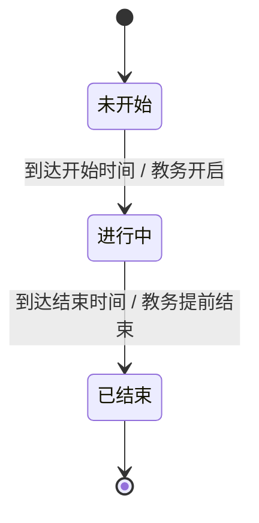
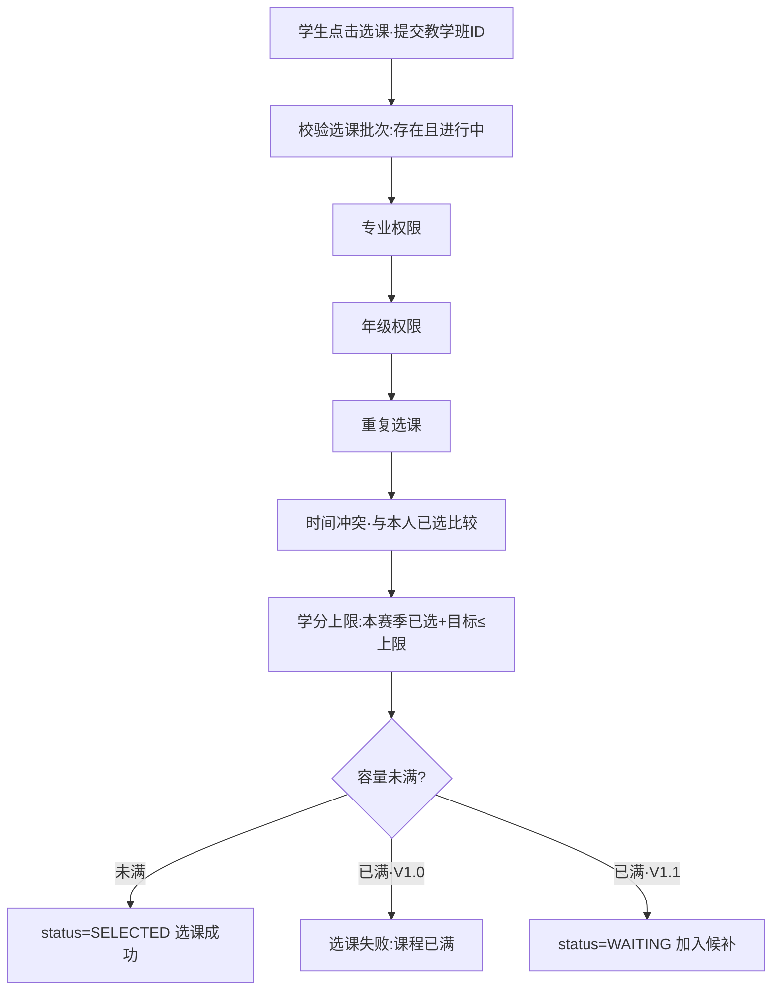
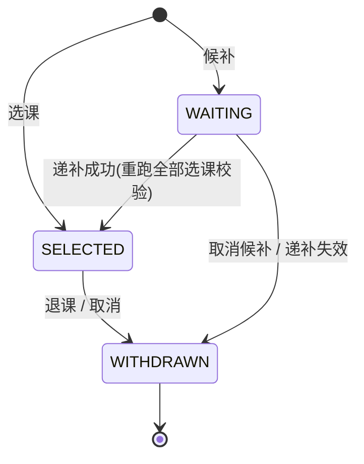
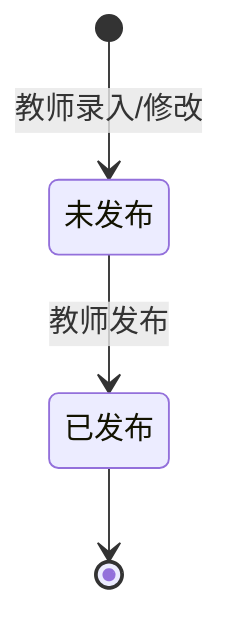
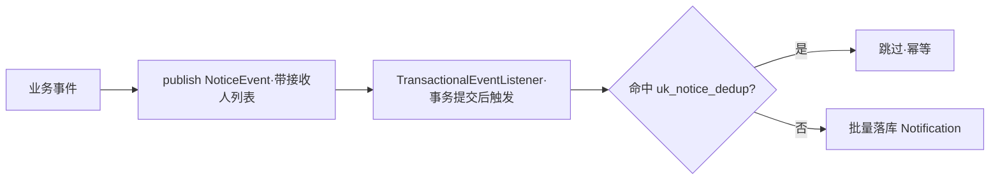

# 高校智慧教务选课平台 · 业务流程设计（V1 + V1.1 整合版）

> 本文档整合《V1.0 业务流程设计》与《V1.1 业务流程设计》，供团队成员快速建立全局认知。
> 内容已对照已实现代码（V1、V1.1 均已落地），是"代码真实跑通的流程"，而非纸面设计。

## 1. 版本范围与约定

- **V1.0**：选课核心闭环（配置 → 选课/退课 → 课表学分 → 成绩）。
- **V1.1（业务增强）**：在 V1 之上补齐 4 条主线——`候补选课 → 系统通知 → 批量导入导出 → 教师成绩统计`。
- V1.1 与 V1 的关系（务必记住）：
  1. V1.0 的校验规则（批次时间、专业年级权限、时间冲突、学分上限、容量校验）在 V1.1 **继续生效**；
  2. 候补学生被递补时，必须**重新跑一遍 V1.0 的完整选课校验**，不允许跳过；
  3. V1 接口行为保持兼容，V1.1 一律通过**新增接口**提供能力。

---

## 2. 三角色与职责

| 角色 | 核心职责 |
|---|---|
| **学生** | 查有权限课程、选课/退课/候补、看课表、看学分、查已发布成绩 |
| **教师** | 看自己教学班与名单、录入/修改/发布成绩、导出名单、看成绩统计 |
| **教学管理员（教务）** | 维护全部基础数据（学生/教师/专业/年级/班级/教室/课程/教学班/排课/批次）、开启关闭选课 |

**权限铁律**：所有越权风险后端**再次校验**，前端篡改参数越不了权（选课、退课、查成绩、查教学班名单均如此）。

---

## 3. 端到端全景流程

```mermaid
flowchart TD
    subgraph 教务配置
        A1[专业→年级→班级→学生→教师→教室] --> A2[课程定义]
        A2 --> A3[创建教学班 + 排课冲突检测]
        A3 --> A4[创建选课批次·时间阀门]
    end
    A4 --> B1[学生查询"自己有权限"的课程]
    B1 --> B2[选课 / 退课 / 候补]
    B2 --> B3[动态生成 课表 / 学分]
    B3 --> C1[教师查看教学班学生名单]
    C1 --> C2[录入 → 发布成绩]
    C2 --> C3[学生查已发布成绩]
    B2 -.名额释放/事件.-> N[系统通知]
    C2 -.发布成绩.-> N
```

---

## 4. 登录与身份识别

登录链路统一：`账号存在? → 密码正确? → 账号启用? → 签发凭证`。

登录后后端识别并缓存关键上下文，驱动后续权限：

- **学生**：学生ID、学号、专业、年级、班级、角色；
- **教师**：教师ID、教师编号、姓名、角色；
- 教务登录后获得全局管理权限，学生/教师**不能**直接调教务接口。

---

## 5. 教务基础数据配置（顺序与校验）

**推荐建数顺序**（后一步依赖前一步存在）：

```text
专业 → 年级 → 班级(绑专业/年级) → 学生(绑三者) → 教师 → 教室 → 课程 → 教学班 → 排课 → 选课批次
```

**建学生/班级的拒绝项**：学号重复、专业/年级/班级不存在、班级与专业不匹配、班级与年级不匹配、登录账号重复。

**删除策略（重要）**：核心实体（学生/教师/课程/学期/教学班/批次）一律**软删（停用=删除语义）**，不提供硬删；纯关联行（排课、批次-教学班关联）才物理删。原因：保护选课/成绩历史、不破坏外键与审计。前端列表页的"删除"按钮 = 后端"停用"，勿假定存在 `DELETE /admin/{entity}/{id}`。

---

## 6. 课程与教学班建模

- **课程 = 定义**（Java程序设计，含学分/性质/适用专业年级）；**教学班 = 某次实际授课**（2026秋 Java 01班 + 张老师 + A101 + 周一1-2节 + 容量60）。二者必须分开。
- **建教学班必跑两道冲突检测**，冲突直接拒绝保存：
  - 教师时间冲突：该教师本学期已有教学班是否时间重叠；
  - 教室时间冲突：该教室本学期排课是否时间重叠。
- 容量存在教学班上，**不冗余存已选人数**（实时统计，避免计数漂移）。

---

## 7. 选课批次（时间阀门）

状态机：



时间校验：选课开始 < 选课结束；若设退课截止，则 退课截止 ≥ 选课开始。已结束批次禁止选/退课。

---

## 8. 学生选课核心流程（六道门禁）



**关键校验规则**：

| 校验 | 规则 |
|---|---|
| 批次 | 存在且状态=进行中 |
| 专业/年级 | 学生专业/年级须匹配教学班适用专业/年级 |
| 重复 | 同一学生同一教学班只能有一条有效记录（唯一键 `uk_selection_student_class` 兜底） |
| 时间冲突 | 与本人已选教学班的上课星期+节次比较，重叠即拒 |
| 学分上限 | 本赛季已选学分 + 目标课程学分 ≤ 上限 |
| 容量 | SELECTED 人数 < 容量 才能正式选上 |

> V1.0 容量满直接失败；V1.1 满则引导"加入候补"（见第 9 节）。

---

## 9. 候补选课（V1.1 核心）

选课记录由二态扩为三态：



- `SELECTED` 正式名额；`WAITING` 占候补队列不占正式名额；`WITHDRAWN` 退课/取消/失效。
- 唯一键保证同一学生同一教学班**只有一条记录**，不可能"既已选又候补"。

**加入候补**：跑完第 8 节的六道门禁后，额外要求"**容量已满**"才允许候补（未满应直接选课）；`waitlist_no = 本班当前最大候补序号 + 1`（**不插队**）。

**取消候补**：校验归属 + 状态=WAITING + 批次进行中；置 WITHDRAWN，`waitlist_no` 保留不清零，后续同学位次实时计算（`<本人且WAITING的数量 + 1`），不重排。

**候补递补（核心）** —— 统一方法 `WaitlistService.tryPromote(teachingClassId)`，三个触发点：

| 触发场景 | 位置 | 事务处理 |
|---|---|---|
| 学生退课释放名额 | `withdrawCourse` | 与退课同事务（名额释放与占用须原子） |
| 教务上调容量释放名额 | 改容量接口 | **事务提交后(afterCommit)回调** |
| 教务手动触发 | 新增教务接口 | — |

> 为什么上调容量走 afterCommit：避免递补异常把教务"纯配置"的容量调整一起回滚。退课触发不受影响（本就该同事务）。

递补流程：算剩余名额 → 取队首(WAITING 且 waitlist_no 最小) → **重跑全部选课校验** → 通过则转 SELECTED（记录 promoted_at、扣 Redis 计数、发通知），不通过则标记 WITHDRAWN 取下一个。循环终止条件：只补足剩余名额，单个名额最多尝试队列全部候补记录。

---

## 10. 退课流程

```text
我的课程 → 退课 → 校验归属(记录须属当前学生) → 校验批次时间允许退课
   → status=WITHDRAWN → 释放名额 → 课表/学分/教师名单同步移除
   → V1.1: 触发 tryPromote 自动递补
```

---

## 11. 课表与学分（动态派生，不双写）

- **课表**：按当前学期有效选课记录动态拼装（星期×节次），不单独存表；
- **学分**：按有效选课 + 已完成成绩统计（本赛季已选/已完成总/必修/专选/公选）；
- 选课记录是唯一事实源，避免选课数据与课表数据双写不一致。

---

## 12. 成绩流程



- 录入/修改仅限**未发布**状态；已发布默认不允许直接改（需教务审批流程另行约定）；
- 学生只能查**已发布**成绩，且只能查自己的；
- 教师成绩统计（V1.1）以**单教学班**为单元：人数、平均分(1位小数)、最高/最低分、及格率(≥60)、优秀率(≥85)、五段分布。**分母为 0 返回 0 不报错**。

---

## 13. 系统通知（V1.1）

**五类通知**：选课开始、选课结束、候补递补成功、课程调整、成绩发布。

**模型**：一人一条站内信（群发=批量插多份）。单表完成未读/已读/列表，无需关联表。**幂等靠唯一键** `uk_notice_dedup(notice_type, biz_id, receiver_user_id)`。

**事件解耦**（为什么这么设计）：



- 监听在事务提交后执行 → 主流程失败不发通知；
- 各业务点只埋一行 publish，不感知通知表结构；
- **幂等注意**：`biz_id` 为 NULL 时 MySQL 唯一索引**不去重**。`COURSE_ADJUSTED` 一律传 `biz_id=NULL`（语义：每次调整都通知），重复投递可能产生重复通知，可接受；其余四类带业务ID正常去重。
- 消费接口：`unread-count` 角标、`notifications` 列表、`{id}/read` 单条已读、`read-all` 全部已读；查询须用当前登录 user_id 过滤，禁止指定他人。

---

## 14. 批量导入导出（V1.1）

| 功能 | 入口 | 要点 |
|---|---|---|
| 导入学生 | 教务 | 模板列：学号/姓名/专业编号/年级名称/班级编号/初始密码(可选)；复用 V1 建号逻辑 |
| 导入教师 | 教务 | 教师编号/姓名/职称(可选)/初始密码(可选) |
| 导出学生 | 教务 | 按筛选条件导出 xlsx |
| 导出名单 | 教师 | 须属自己教学班；导出 SELECTED 学生 |
| 导入成绩 | 教师 | 学号/成绩；校验属本班且未发布；存在则更新不存在则插入 |

**通用约定**：Apache POI 5.4.1（离线可用）；仅 `.xlsx`（`.xls` 拒绝）；表头须匹配模板；**逐行 try/catch，不包外层大事务**（单行失败记原因继续，不污染整批）；导入**不接 Redis/消息队列**，同步执行让教务立即看到结果。返回 `ImportResultRespDTO(total/success/fail/failList)`。

---

## 15. 核心状态机总表

| 对象 | 状态 |
|---|---|
| 账号 | 启用 / 禁用 |
| 选课批次 | 未开始 / 进行中 / 已结束 |
| 选课记录 | SELECTED(已选) / WAITING(候补) / WITHDRAWN(已退/已取消/失效) |
| 成绩 | 未发布 / 已发布 |

---

## 16. 权限边界速查

| | 能 | 不能 |
|---|---|---|
| **学生** | 看本人数据/有权限课程/操作本人选课/查本人成绩课表学分 | 查无权限课程、退他人课、查他人成绩、访问教师/教务接口 |
| **教师** | 看本人教学班与名单、录/改/发本人成绩、导出本人名单、看本人统计 | 看他人教学班、改他人成绩、管学生/课程/批次 |
| **教务** | 全局配置上述所有基础数据、管批次开关 | — |

---

## 17. 关键业务异常

- **登录**：账号不存在 / 密码错 / 已禁用 / 状态过期；
- **选课**：非选课时间、课程不存在、未开放、专业/年级不符、重复、时间冲突、超学分、已满；
- **退课**：不允许退课、记录不存在、非本人、已退过；
- **教学班**：教师冲突 / 教室冲突 / 容量非法；
- **成绩**：无权限、学生不符、格式错、已发布重复改、查未发布。

---

## 18. 贯穿全局的设计决策

1. **不硬删**：核心实体软删（停用=删除），`ON DELETE RESTRICT` 外键天然支撑，保护历史与审计；
2. **动态派生**：课表/学分不双写，选课记录是唯一事实源；
3. **事件解耦通知**：事务提交后才发（afterCommit）+ 唯一键幂等，主流程失败不污染通知；
4. **三角色权限隔离 + 后端再校验**：前端参数不可信，所有越权后端重算；
5. **唯一键兜底**：`uk_selection_student_class`（同生同班一条）、`uk_notice_dedup`（通知幂等）。

---

## 19. 端到端演示（V1.1 三条链路）

**候补链路**：教务开小容量班 → A..N 选满 → X 满员加入候补(看位次) → A 退课释放名额 → 自动递补 X 转 SELECTED + 收候补成功通知 → X 课表出现该课。

**通知链路**：教务开批次 → 批量生成选课开始通知 → 学生登录角标+1 → 点击标记已读；教师发布成绩 → 事务提交后该班学生收成绩发布通知。

**导入导出链路**：教务下模板填好上传导入(看成功/失败明细) → 按专业导出学生 → 教师导出名单 → 教师上传成绩导入 → 看成绩统计。

---

> 原始拆分文档：`高校智慧教务选课平台_V1业务流程设计.md`、`V1.1_业务流程设计.md`（可作为本整合版的细节备查，确认整合无误后可归档）。
